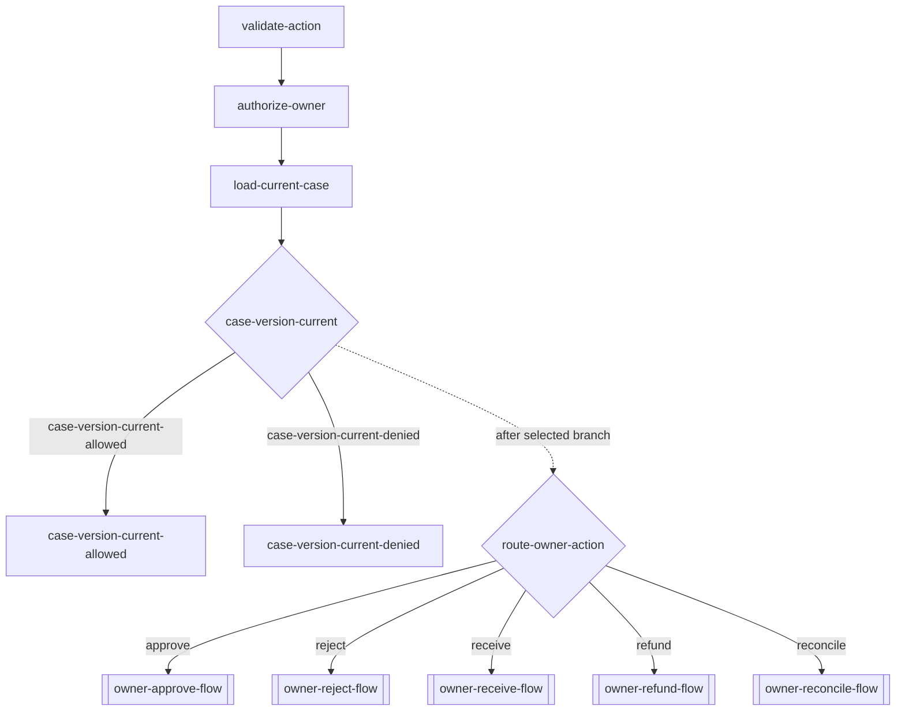
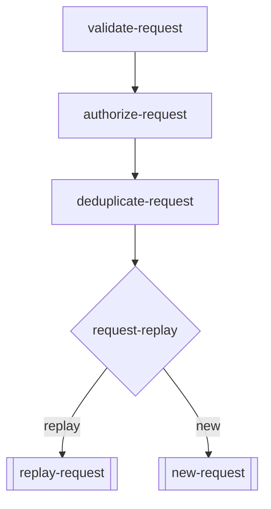

<!-- Generated by scripts/developer/flow-docs.mjs; do not edit this file. -->
# After-sales chart navigation

## Generated after-sales chart views

Production/generator input SHA-256: `c3dda52a438dccdb496760bcb029b297e28aeda31e7a4a13e3462ea8aa410b27`. Actual registered builders: FootPrintJS 12.0.0 `toMermaid()` topology plus native control metadata; callbacks/providers are not run.

### [aftersales-action](../views/validate-action-3ca46934d91a/README.md)

### [aftersales-request](../views/validate-request-07c1344f12e1/README.md)

Native SDK topology with metadata-bound annotations: diamonds are actual decisions/selectors; double-sided boxes are subflows; hexagons are parallel forks; branch arrows show actual keys. Dashed “after selected/parallel branches” arrows are continuations after those branches complete, not bypass paths. Loop arrows are native back-edges. Callback exceptions, breaks, private predicates and host effects are not simulated; nested mounts open separate views.

Open each root view for every actual mounted subflow, guard and hook source. Host ports/private payloads remain opaque; no callback is executed.
