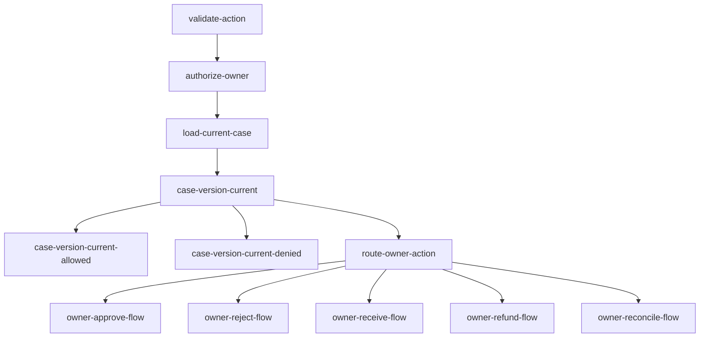
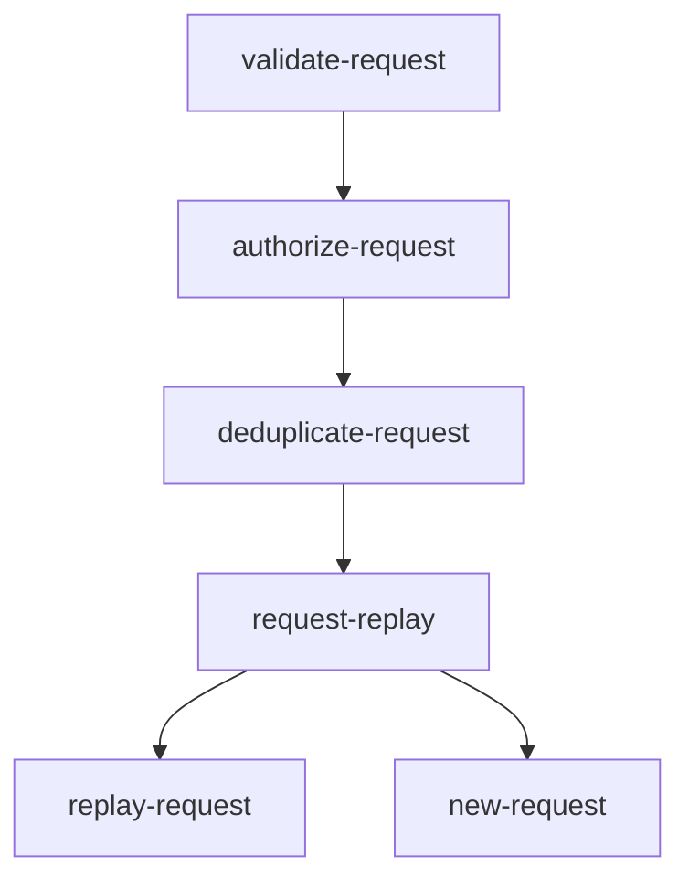

<!-- Generated by scripts/developer/flow-docs.mjs; do not edit this file. -->
# After-sales chart navigation

## Generated after-sales chart views

Production/generator input SHA-256: `0e120058e4b1c4edb368f3cb91abbea2f775ad545a0887b41d8eec057a831963`. Generated from actual registered builders using FootPrintJS 12.0.0 `toMermaid()`; callbacks/providers are not run.

### [aftersales-action](../views/validate-action-5acb262f04c9/README.md)

### [aftersales-request](../views/validate-request-d41e10cf73a7/README.md)

Open each root view for every actual mounted subflow, guard and hook source. Host ports/private payloads remain opaque; no callback is executed.
