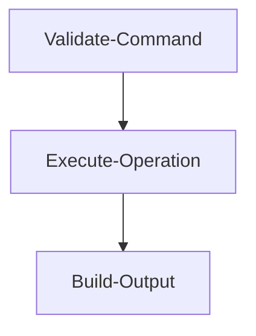

<!-- Generated by scripts/developer/flow-docs.mjs; do not edit this file. -->
# Default service chart navigation

## Generated default service charts

Production/generator input SHA-256: `d104c5c94cac5a9af6308d3376c02ec00be4922a34f0bc25d00e8b421368c8d5`. Actual registered builders: FootPrintJS 12.0.0 `toMermaid()` topology plus native control metadata; callbacks/providers are not run.

Actual default registry membership: [archive-product](../views/validate-command-3af82d0c935a/README.md), [create-campaign](../views/validate-command-3af82d0c935a/README.md), [create-order](../views/validate-command-3af82d0c935a/README.md), [create-product](../views/validate-command-3af82d0c935a/README.md), [create-subscriber](../views/validate-command-3af82d0c935a/README.md), [process-payment](../views/validate-command-3af82d0c935a/README.md), [publish-storefront](../views/validate-command-3af82d0c935a/README.md), [schedule-campaign](../views/validate-command-3af82d0c935a/README.md), [send-campaign-batch](../views/validate-command-3af82d0c935a/README.md), [unsubscribe](../views/validate-command-3af82d0c935a/README.md), [update-product](../views/validate-command-3af82d0c935a/README.md), [update-stock](../views/validate-command-3af82d0c935a/README.md).

These are library request envelopes. The configured authoritative host operation is opaque. Custom application registries/builders are not executed or inferred.
