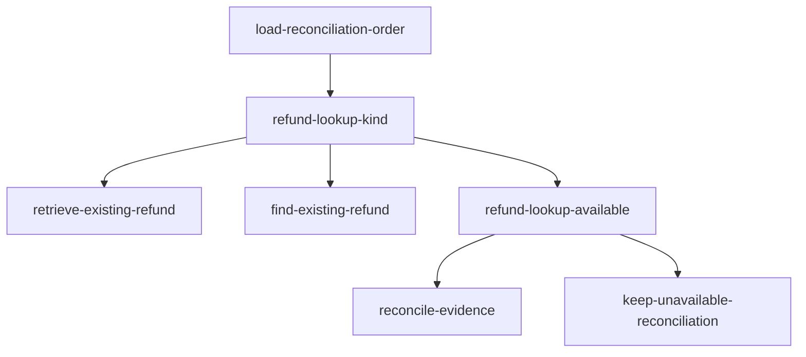

<!-- Generated by scripts/developer/flow-docs.mjs; do not edit this file. -->
# load-reconciliation-order

Production/generator input SHA-256: `0e120058e4b1c4edb368f3cb91abbea2f775ad545a0887b41d8eec057a831963`. Generated from actual registered builders using FootPrintJS 12.0.0 `toMermaid()`; callbacks/providers are not run.

Chart links target checkout sources. In an installed package use developer/node with the logical `src/...` ID; its manifest resolves `dist/source/...`. Hashes/line spans bind views to source. Static diagrams are not runtime evidence or complete host semantics.

This native topology view is used by 2 registered mount instance(s). Stable local aliases remove only the actual mount prefix; the complete actual-ID mapping and contexts are in [the manifest](../../manifest.json). Shared diagrams assert matching topology only, not identical private helper semantics.

## Decisions and loops

| Stage | Branch / control | Destination |
| --- | --- | --- |
| refund-lookup-kind | retrieve | retrieve-existing-refund |
| refund-lookup-kind | find | find-existing-refund |
| refund-lookup-available | available | reconcile-evidence |
| refund-lookup-available | unavailable | keep-unavailable-reconciliation |

## Open a subflow

| Mount | Native subflow view | Mapping declarations |
| --- | --- | --- |
| available | [reconcile-evidence](../read-refund-evidence-presence-0d18dca3cab7/README.md) | inputMapper, outputMapper |

## Guard and hook source

| Stage | Role | Source / boundary |
| --- | --- | --- |
| load-reconciliation-order | hook | [src/aftersales/runtime.ts:348](../../../../src/aftersales/runtime.ts#L348) · direct safe writes: `hasProviderRefundId` |
| refund-lookup-kind | decision | [src/aftersales/flowCharts.ts:134](../../../../src/aftersales/flowCharts.ts#L134) · [callback](../../../../src/aftersales/flowCharts.ts#L135) |
| retrieve | hook | [src/aftersales/runtime.ts:349](../../../../src/aftersales/runtime.ts#L349) · direct safe writes: `reconciliationAvailable` · opaque payments.retrieveRefund |
| find | hook | [src/aftersales/runtime.ts:354](../../../../src/aftersales/runtime.ts#L354) · direct safe writes: `reconciliationAvailable` · opaque payments.findRefund |
| refund-lookup-available | decision | [src/aftersales/flowCharts.ts:134](../../../../src/aftersales/flowCharts.ts#L134) · [callback](../../../../src/aftersales/flowCharts.ts#L138) |
| unavailable | hook | [src/aftersales/runtime.ts:362](../../../../src/aftersales/runtime.ts#L362) · direct safe writes: `outcome` |

[All registered flows](../../README.md)
