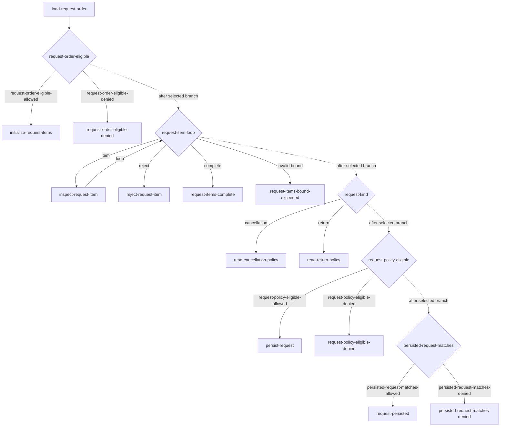

<!-- Generated by scripts/developer/flow-docs.mjs; do not edit this file. -->
# load-request-order

Production/generator input SHA-256: `c3dda52a438dccdb496760bcb029b297e28aeda31e7a4a13e3462ea8aa410b27`. Actual registered builders: FootPrintJS 12.0.0 `toMermaid()` topology plus native control metadata; callbacks/providers are not run.

Chart links target checkout sources. In an installed package use developer/node with the logical `src/...` ID; its manifest resolves `dist/source/...`. Hashes/line spans bind views to source. Static diagrams are not runtime evidence or complete host semantics.

Native SDK topology with metadata-bound annotations: diamonds are actual decisions/selectors; double-sided boxes are subflows; hexagons are parallel forks; branch arrows show actual keys. Dashed “after selected/parallel branches” arrows are continuations after those branches complete, not bypass paths. Loop arrows are native back-edges. Callback exceptions, breaks, private predicates and host effects are not simulated; nested mounts open separate views.

This native topology view is used by 1 registered mount instance(s). Stable local aliases remove only the actual mount prefix; the complete actual-ID mapping, raw SDK text and edge-multiset proof are in [the manifest](../../manifest.json). Shared diagrams assert matching topology only, not identical private helper semantics.

## Decisions and loops

| Stage | Branch / control | Destination |
| --- | --- | --- |
| request-order-eligible | request-order-eligible-allowed | initialize-request-items |
| request-order-eligible | request-order-eligible-denied | request-order-eligible-denied |
| request-item-loop | item | inspect-request-item |
| request-item-loop | reject | reject-request-item |
| request-item-loop | complete | request-items-complete |
| request-item-loop | invalid-bound | request-items-bound-exceeded |
| item | loop back-edge | request-item-loop |
| request-kind | cancellation | read-cancellation-policy |
| request-kind | return | read-return-policy |
| request-policy-eligible | request-policy-eligible-allowed | persist-request |
| request-policy-eligible | request-policy-eligible-denied | request-policy-eligible-denied |
| persisted-request-matches | persisted-request-matches-allowed | request-persisted |
| persisted-request-matches | persisted-request-matches-denied | persisted-request-matches-denied |

## Guard and hook source

| Stage | Role | Source / boundary |
| --- | --- | --- |
| load-request-order | hook | [src/aftersales/runtime.ts:226](../../../../src/aftersales/runtime.ts#L226) · direct safe writes: `orderStateEligible`, `requestKind` |
| request-order-eligible | decision | [src/aftersales/flowCharts.ts:56](../../../../src/aftersales/flowCharts.ts#L56) · safe fact `orderStateEligible` · [guard helper](../../../../src/aftersales/flowCharts.ts#L45) |
| request-order-eligible-allowed | hook | [src/aftersales/runtime.ts:230](../../../../src/aftersales/runtime.ts#L230) · direct safe writes: `itemCount`, `itemIndex` |
| request-order-eligible-denied | hook | [src/aftersales/runtime.ts:204](../../../../src/aftersales/runtime.ts#L204) · helper effects require source inspection |
| request-item-loop | decision | [src/aftersales/flowCharts.ts:56](../../../../src/aftersales/flowCharts.ts#L56) · [callback](../../../../src/aftersales/flowCharts.ts#L59) |
| item | hook | [src/aftersales/runtime.ts:231](../../../../src/aftersales/runtime.ts#L231) · direct safe writes: `itemIndex`, `lineCheck`, `lineEligible` |
| reject | hook | [src/aftersales/runtime.ts:204](../../../../src/aftersales/runtime.ts#L204) · helper effects require source inspection |
| invalid-bound | hook | [src/aftersales/runtime.ts:204](../../../../src/aftersales/runtime.ts#L204) · helper effects require source inspection |
| request-kind | decision | [src/aftersales/flowCharts.ts:56](../../../../src/aftersales/flowCharts.ts#L56) · [callback](../../../../src/aftersales/flowCharts.ts#L65) |
| cancellation | hook | [src/aftersales/runtime.ts:238](../../../../src/aftersales/runtime.ts#L238) · direct safe writes: `cancellationEligible`, `policySatisfied` |
| return | hook | [src/aftersales/runtime.ts:242](../../../../src/aftersales/runtime.ts#L242) · direct safe writes: `policySatisfied`, `returnEligible` |
| request-policy-eligible | decision | [src/aftersales/flowCharts.ts:69](../../../../src/aftersales/flowCharts.ts#L69) · safe fact `policySatisfied` · [guard helper](../../../../src/aftersales/flowCharts.ts#L45) |
| request-policy-eligible-allowed | hook | [src/aftersales/runtime.ts:248](../../../../src/aftersales/runtime.ts#L248) · direct safe writes: `persistedRequestMatches` · opaque repository.createCase |
| request-policy-eligible-denied | hook | [src/aftersales/runtime.ts:204](../../../../src/aftersales/runtime.ts#L204) · helper effects require source inspection |
| persisted-request-matches | decision | [src/aftersales/flowCharts.ts:70](../../../../src/aftersales/flowCharts.ts#L70) · safe fact `persistedRequestMatches` · [guard helper](../../../../src/aftersales/flowCharts.ts#L45) |
| persisted-request-matches-allowed | hook | [src/aftersales/runtime.ts:257](../../../../src/aftersales/runtime.ts#L257) · direct safe writes: `outcome` |
| persisted-request-matches-denied | hook | [src/aftersales/runtime.ts:204](../../../../src/aftersales/runtime.ts#L204) · helper effects require source inspection |

[All registered flows](../../README.md)
