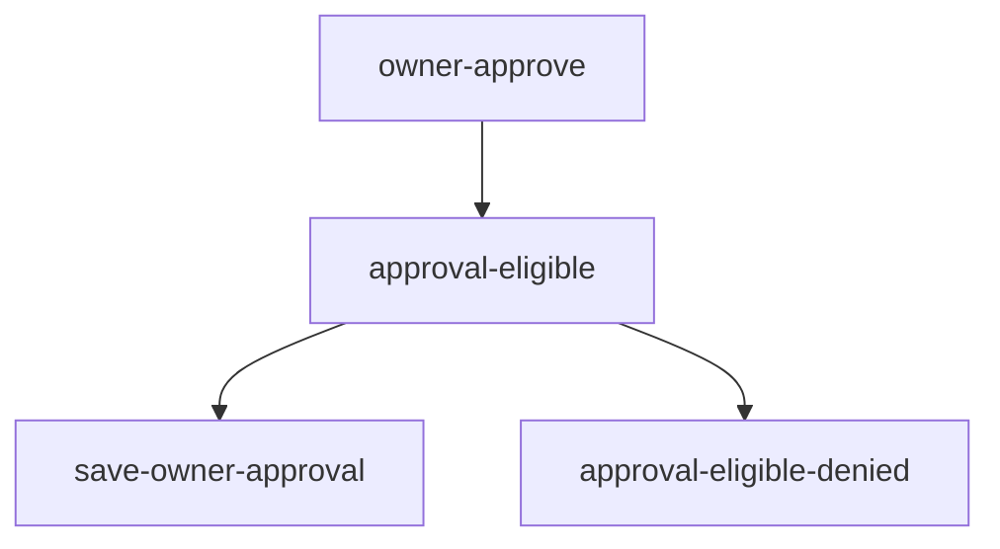

<!-- Generated by scripts/developer/flow-docs.mjs; do not edit this file. -->
# owner-approve

Production/generator input SHA-256: `0e120058e4b1c4edb368f3cb91abbea2f775ad545a0887b41d8eec057a831963`. Generated from actual registered builders using FootPrintJS 12.0.0 `toMermaid()`; callbacks/providers are not run.

Chart links target checkout sources. In an installed package use developer/node with the logical `src/...` ID; its manifest resolves `dist/source/...`. Hashes/line spans bind views to source. Static diagrams are not runtime evidence or complete host semantics.

This native topology view is used by 1 registered mount instance(s). Stable local aliases remove only the actual mount prefix; the complete actual-ID mapping and contexts are in [the manifest](../../manifest.json). Shared diagrams assert matching topology only, not identical private helper semantics.

## Decisions and loops

| Stage | Branch / control | Destination |
| --- | --- | --- |
| approval-eligible | approval-eligible-allowed | save-owner-approval |
| approval-eligible | approval-eligible-denied | approval-eligible-denied |

## Guard and hook source

| Stage | Role | Source / boundary |
| --- | --- | --- |
| owner-approve | hook | [src/aftersales/runtime.ts:290](../../../../src/aftersales/runtime.ts#L290) · direct safe writes: `ownerActionEligible` |
| approval-eligible | decision | [src/aftersales/flowCharts.ts:170](../../../../src/aftersales/flowCharts.ts#L170) · safe fact `ownerActionEligible` · [guard helper](../../../../src/aftersales/flowCharts.ts#L45) |
| approval-eligible-allowed | hook | [src/aftersales/runtime.ts:291](../../../../src/aftersales/runtime.ts#L291) · direct safe writes: `outcome` · opaque repository.saveCase |
| approval-eligible-denied | hook | [src/aftersales/runtime.ts:204](../../../../src/aftersales/runtime.ts#L204) · helper effects require source inspection |

[All registered flows](../../README.md)
