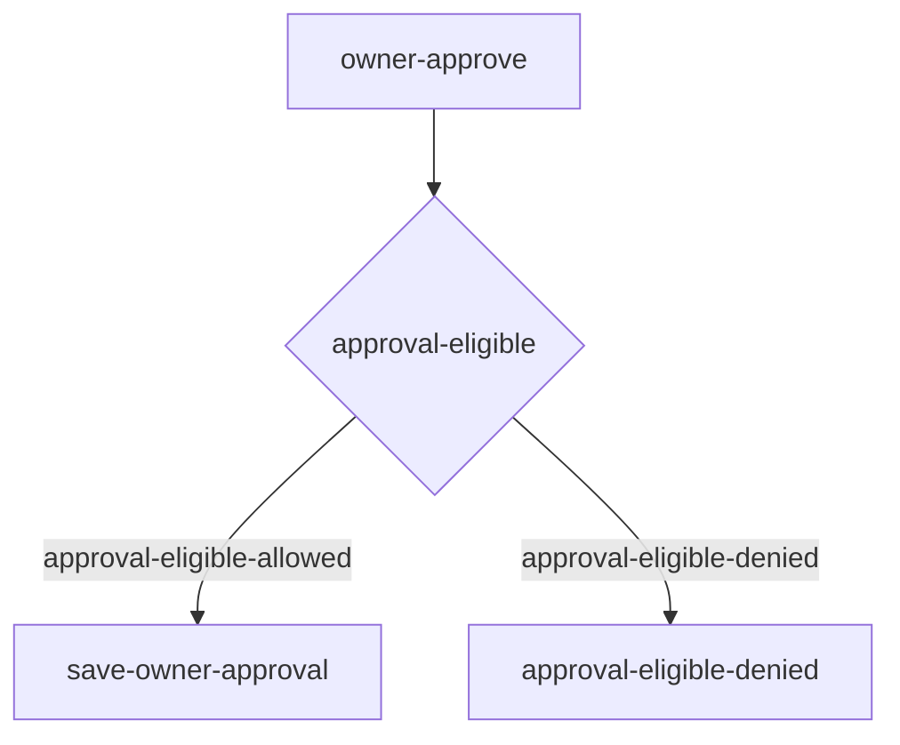

<!-- Generated by scripts/developer/flow-docs.mjs; do not edit this file. -->
# owner-approve

Production/generator input SHA-256: `54ba490387d9ff380883910fbc0d35f5972f48e24193d35e980959ef15ed7649`. Actual registered builders: FootPrintJS 12.0.0 `toMermaid()` topology plus native control metadata; callbacks/providers are not run.

Chart links target checkout sources. In an installed package use developer/node with the logical `src/...` ID; its manifest resolves `dist/source/...`. Hashes/line spans bind views to source. Static diagrams are not runtime evidence or complete host semantics.

Native SDK topology with metadata-bound annotations: diamonds are actual decisions/selectors; double-sided boxes are subflows; hexagons are parallel forks; branch arrows show actual keys. Dashed “after selected/parallel branches” arrows are continuations after those branches complete, not bypass paths. Loop arrows are native back-edges. Callback exceptions, breaks, private predicates and host effects are not simulated; nested mounts open separate views.

This native topology view is used by 1 registered mount instance(s). Stable local aliases remove only the actual mount prefix; the complete actual-ID mapping, raw SDK text and edge-multiset proof are in [the manifest](../../manifest.json). Shared diagrams assert matching topology only, not identical private helper semantics.

## Algorithm

Generated from actual native stage labels and edges. Branch callbacks and host effects are not inferred. Numbering is a node inventory, not an execution trace.

1. Stage owner-approve [owner-approve]. Continuation: approval-eligible.
2. Decision approval-eligible [approval-eligible]. Branches: approval-eligible-allowed → approval-eligible-allowed; approval-eligible-denied → approval-eligible-denied. Continuation: end of this local path.
3. Stage save-owner-approval [approval-eligible-allowed]. Continuation: end of this local path.
4. Stage approval-eligible-denied [approval-eligible-denied]. Continuation: end of this local path.

## Decisions and loops

| Stage | Branch / control | Destination |
| --- | --- | --- |
| approval-eligible | approval-eligible-allowed | save-owner-approval |
| approval-eligible | approval-eligible-denied | approval-eligible-denied |

## Guard and hook source

| Stage | Role | Source / boundary |
| --- | --- | --- |
| owner-approve | hook | [src/aftersales/runtime.ts:290](../../../../src/aftersales/runtime.ts#L290) · direct safe writes: `ownerActionEligible` |
| approval-eligible | decision | [src/aftersales/flowCharts.ts:170](../../../../src/aftersales/flowCharts.ts#L170) · safe fact `ownerActionEligible` · [guard helper](../../../../src/aftersales/flowCharts.ts#L45) |
| approval-eligible-allowed | hook | [src/aftersales/runtime.ts:291](../../../../src/aftersales/runtime.ts#L291) · direct safe writes: `outcome` · opaque repository.saveCase |
| approval-eligible-denied | hook | [src/aftersales/runtime.ts:204](../../../../src/aftersales/runtime.ts#L204) · helper effects require source inspection |

[All registered flows](../../README.md)
