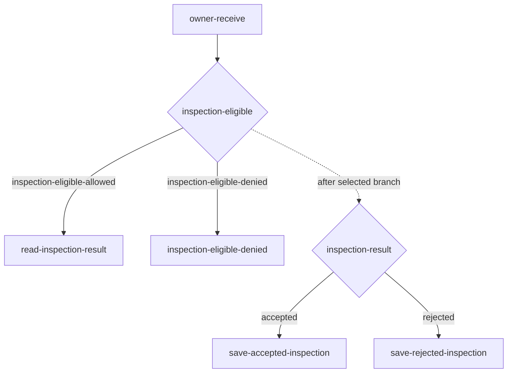

<!-- Generated by scripts/developer/flow-docs.mjs; do not edit this file. -->
# owner-receive

Production/generator input SHA-256: `54ba490387d9ff380883910fbc0d35f5972f48e24193d35e980959ef15ed7649`. Actual registered builders: FootPrintJS 12.0.0 `toMermaid()` topology plus native control metadata; callbacks/providers are not run.

Chart links target checkout sources. In an installed package use developer/node with the logical `src/...` ID; its manifest resolves `dist/source/...`. Hashes/line spans bind views to source. Static diagrams are not runtime evidence or complete host semantics.

Native SDK topology with metadata-bound annotations: diamonds are actual decisions/selectors; double-sided boxes are subflows; hexagons are parallel forks; branch arrows show actual keys. Dashed “after selected/parallel branches” arrows are continuations after those branches complete, not bypass paths. Loop arrows are native back-edges. Callback exceptions, breaks, private predicates and host effects are not simulated; nested mounts open separate views.

This native topology view is used by 1 registered mount instance(s). Stable local aliases remove only the actual mount prefix; the complete actual-ID mapping, raw SDK text and edge-multiset proof are in [the manifest](../../manifest.json). Shared diagrams assert matching topology only, not identical private helper semantics.

## Algorithm

Generated from actual native stage labels and edges. Branch callbacks and host effects are not inferred. Numbering is a node inventory, not an execution trace.

1. Stage owner-receive [owner-receive]. Continuation: inspection-eligible.
2. Decision inspection-eligible [inspection-eligible]. Branches: inspection-eligible-allowed → inspection-eligible-allowed; inspection-eligible-denied → inspection-eligible-denied. Continuation: inspection-result.
3. Stage read-inspection-result [inspection-eligible-allowed]. Continuation: end of this local path.
4. Stage inspection-eligible-denied [inspection-eligible-denied]. Continuation: end of this local path.
5. Decision inspection-result [inspection-result]. Branches: accepted → accepted; rejected → rejected. Continuation: end of this local path.
6. Stage save-accepted-inspection [accepted]. Continuation: end of this local path.
7. Stage save-rejected-inspection [rejected]. Continuation: end of this local path.

## Decisions and loops

| Stage | Branch / control | Destination |
| --- | --- | --- |
| inspection-eligible | inspection-eligible-allowed | read-inspection-result |
| inspection-eligible | inspection-eligible-denied | inspection-eligible-denied |
| inspection-result | accepted | save-accepted-inspection |
| inspection-result | rejected | save-rejected-inspection |

## Guard and hook source

| Stage | Role | Source / boundary |
| --- | --- | --- |
| owner-receive | hook | [src/aftersales/runtime.ts:303](../../../../src/aftersales/runtime.ts#L303) · direct safe writes: `ownerActionEligible` |
| inspection-eligible | decision | [src/aftersales/flowCharts.ts:172](../../../../src/aftersales/flowCharts.ts#L172) · safe fact `ownerActionEligible` · [guard helper](../../../../src/aftersales/flowCharts.ts#L45) |
| inspection-eligible-allowed | hook | [src/aftersales/runtime.ts:304](../../../../src/aftersales/runtime.ts#L304) · direct safe writes: `inspectionAccepted` |
| inspection-eligible-denied | hook | [src/aftersales/runtime.ts:204](../../../../src/aftersales/runtime.ts#L204) · helper effects require source inspection |
| inspection-result | decision | [src/aftersales/flowCharts.ts:172](../../../../src/aftersales/flowCharts.ts#L172) · [callback](../../../../src/aftersales/flowCharts.ts#L173) |
| accepted | hook | [src/aftersales/runtime.ts:305](../../../../src/aftersales/runtime.ts#L305) · helper effects require source inspection |
| rejected | hook | [src/aftersales/runtime.ts:306](../../../../src/aftersales/runtime.ts#L306) · helper effects require source inspection |

[All registered flows](../../README.md)
