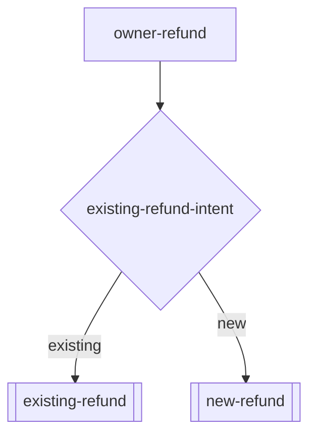

<!-- Generated by scripts/developer/flow-docs.mjs; do not edit this file. -->
# owner-refund

Production/generator input SHA-256: `63cd739980109052a9bfa607a1cf3aff1566ff3bd6677ccf64dd974142ecb3e0`. Actual registered builders: FootPrintJS 12.0.0 `toMermaid()` topology plus native control metadata; callbacks/providers are not run.

Chart links target checkout sources. In an installed package use developer/node with the logical `src/...` ID; its manifest resolves `dist/source/...`. Hashes/line spans bind views to source. Static diagrams are not runtime evidence or complete host semantics.

Native SDK topology with metadata-bound annotations: diamonds are actual decisions/selectors; double-sided boxes are subflows; hexagons are parallel forks; branch arrows show actual keys. Dashed “after selected/parallel branches” arrows are continuations after those branches complete, not bypass paths. Loop arrows are native back-edges. Callback exceptions, breaks, private predicates and host effects are not simulated; nested mounts open separate views.

This native topology view is used by 1 registered mount instance(s). Stable local aliases remove only the actual mount prefix; the complete actual-ID mapping, raw SDK text and edge-multiset proof are in [the manifest](../../manifest.json). Shared diagrams assert matching topology only, not identical private helper semantics.

## Decisions and loops

| Stage | Branch / control | Destination |
| --- | --- | --- |
| existing-refund-intent | existing | existing-refund |
| existing-refund-intent | new | new-refund |

## Open a subflow

| Mount | Native subflow view | Mapping declarations |
| --- | --- | --- |
| existing | [existing-refund](../read-existing-refund-command-831a7bbd0ef1/README.md) | inputMapper, outputMapper |
| new | [new-refund](../read-refund-eligibility-9bf14817441a/README.md) | inputMapper, outputMapper |

## Guard and hook source

| Stage | Role | Source / boundary |
| --- | --- | --- |
| owner-refund | hook | [src/aftersales/runtime.ts:307](../../../../src/aftersales/runtime.ts#L307) · direct safe writes: `hasExistingRefund` |
| existing-refund-intent | decision | [src/aftersales/flowCharts.ts:163](../../../../src/aftersales/flowCharts.ts#L163) · [callback](../../../../src/aftersales/flowCharts.ts#L164) |

[All registered flows](../../README.md)
