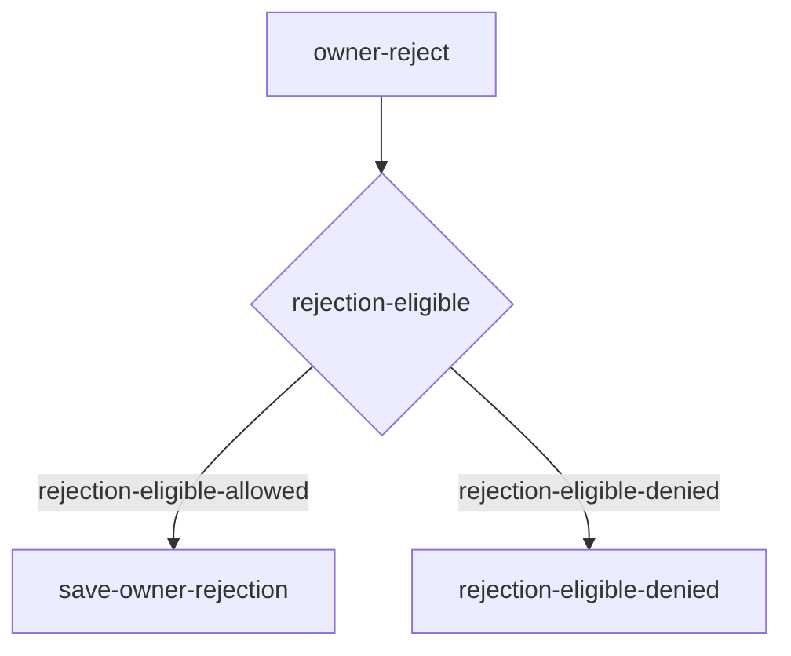

<!-- Generated by scripts/developer/flow-docs.mjs; do not edit this file. -->
# owner-reject

Production/generator input SHA-256: `d104c5c94cac5a9af6308d3376c02ec00be4922a34f0bc25d00e8b421368c8d5`. Actual registered builders: FootPrintJS 12.0.0 `toMermaid()` topology plus native control metadata; callbacks/providers are not run.

Chart links target checkout sources. In an installed package use developer/node with the logical `src/...` ID; its manifest resolves `dist/source/...`. Hashes/line spans bind views to source. Static diagrams are not runtime evidence or complete host semantics.

Native SDK topology with metadata-bound annotations: diamonds are actual decisions/selectors; double-sided boxes are subflows; hexagons are parallel forks; branch arrows show actual keys. Dashed “after selected/parallel branches” arrows are continuations after those branches complete, not bypass paths. Loop arrows are native back-edges. Callback exceptions, breaks, private predicates and host effects are not simulated; nested mounts open separate views.

This native topology view is used by 1 registered mount instance(s). Stable local aliases remove only the actual mount prefix; the complete actual-ID mapping, raw SDK text and edge-multiset proof are in [the manifest](../../manifest.json). Shared diagrams assert matching topology only, not identical private helper semantics.

## Decisions and loops

| Stage | Branch / control | Destination |
| --- | --- | --- |
| rejection-eligible | rejection-eligible-allowed | save-owner-rejection |
| rejection-eligible | rejection-eligible-denied | rejection-eligible-denied |

## Guard and hook source

| Stage | Role | Source / boundary |
| --- | --- | --- |
| owner-reject | hook | [src/aftersales/runtime.ts:297](../../../../src/aftersales/runtime.ts#L297) · direct safe writes: `ownerActionEligible` |
| rejection-eligible | decision | [src/aftersales/flowCharts.ts:171](../../../../src/aftersales/flowCharts.ts#L171) · safe fact `ownerActionEligible` · [guard helper](../../../../src/aftersales/flowCharts.ts#L45) |
| rejection-eligible-allowed | hook | [src/aftersales/runtime.ts:298](../../../../src/aftersales/runtime.ts#L298) · direct safe writes: `outcome` · opaque repository.saveCase |
| rejection-eligible-denied | hook | [src/aftersales/runtime.ts:204](../../../../src/aftersales/runtime.ts#L204) · helper effects require source inspection |

[All registered flows](../../README.md)
