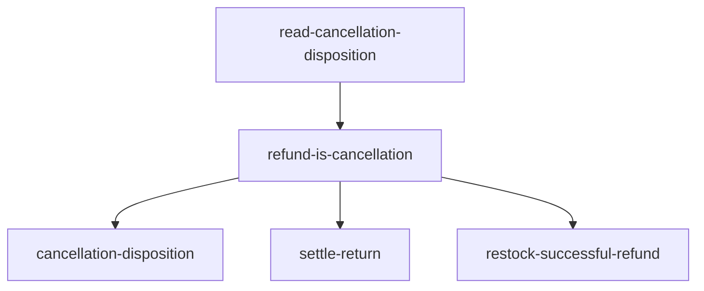

<!-- Generated by scripts/developer/flow-docs.mjs; do not edit this file. -->
# read-cancellation-disposition

Production/generator input SHA-256: `0e120058e4b1c4edb368f3cb91abbea2f775ad545a0887b41d8eec057a831963`. Generated from actual registered builders using FootPrintJS 12.0.0 `toMermaid()`; callbacks/providers are not run.

Chart links target checkout sources. In an installed package use developer/node with the logical `src/...` ID; its manifest resolves `dist/source/...`. Hashes/line spans bind views to source. Static diagrams are not runtime evidence or complete host semantics.

This native topology view is used by 6 registered mount instance(s). Stable local aliases remove only the actual mount prefix; the complete actual-ID mapping and contexts are in [the manifest](../../manifest.json). Shared diagrams assert matching topology only, not identical private helper semantics.

## Decisions and loops

| Stage | Branch / control | Destination |
| --- | --- | --- |
| refund-is-cancellation | cancellation | cancellation-disposition |
| refund-is-cancellation | return | settle-return |

## Open a subflow

| Mount | Native subflow view | Mapping declarations |
| --- | --- | --- |
| cancellation | [cancellation-disposition](../read-full-cancellation-93d8689e179a/README.md) | inputMapper, outputMapper |
| restock-successful-refund | [restock-successful-refund](../read-restock-status-7f4ce6d2eaef/README.md) | inputMapper, outputMapper |

## Guard and hook source

| Stage | Role | Source / boundary |
| --- | --- | --- |
| read-cancellation-disposition | hook | [src/aftersales/runtime.ts:372](../../../../src/aftersales/runtime.ts#L372) · direct safe writes: `cancellationRefund` |
| refund-is-cancellation | decision | [src/aftersales/flowCharts.ts:100](../../../../src/aftersales/flowCharts.ts#L100) · [callback](../../../../src/aftersales/flowCharts.ts#L101) |
| return | hook | [src/aftersales/runtime.ts:376](../../../../src/aftersales/runtime.ts#L376) · helper effects require source inspection |

[All registered flows](../../README.md)
