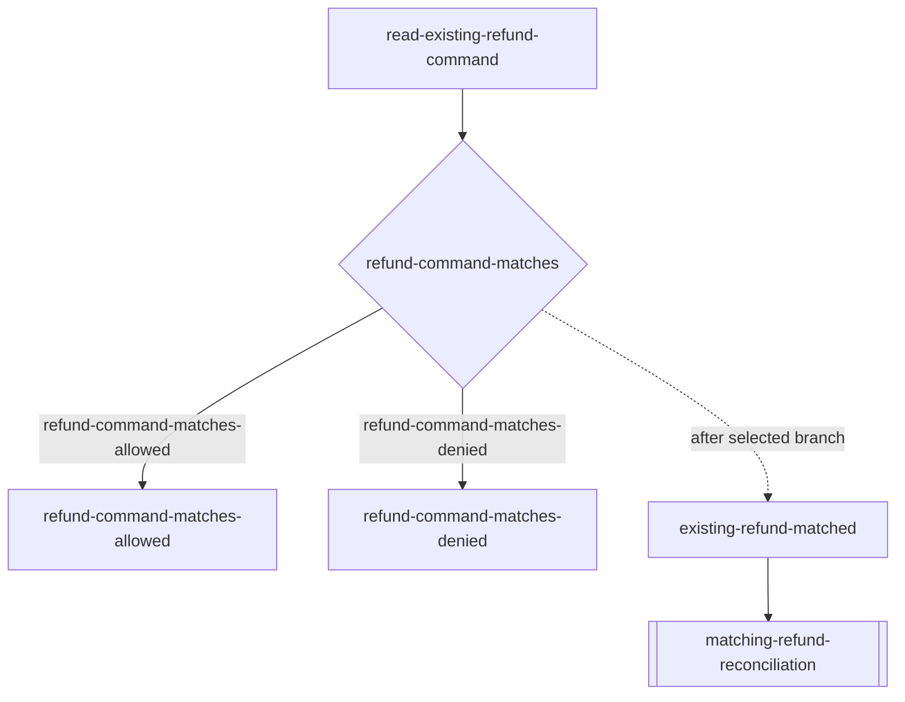

<!-- Generated by scripts/developer/flow-docs.mjs; do not edit this file. -->
# read-existing-refund-command

Production/generator input SHA-256: `13517c9c684a32e0c2c721ce13e169b03e23eecc32e8fc99366938a759fd3439`. Actual registered builders: FootPrintJS 12.0.0 `toMermaid()` topology plus native control metadata; callbacks/providers are not run.

Chart links target checkout sources. In an installed package use developer/node with the logical `src/...` ID; its manifest resolves `dist/source/...`. Hashes/line spans bind views to source. Static diagrams are not runtime evidence or complete host semantics.

Native SDK topology with metadata-bound annotations: diamonds are actual decisions/selectors; double-sided boxes are subflows; hexagons are parallel forks; branch arrows show actual keys. Dashed “after selected/parallel branches” arrows are continuations after those branches complete, not bypass paths. Loop arrows are native back-edges. Callback exceptions, breaks, private predicates and host effects are not simulated; nested mounts open separate views.

This native topology view is used by 1 registered mount instance(s). Stable local aliases remove only the actual mount prefix; the complete actual-ID mapping, raw SDK text and edge-multiset proof are in [the manifest](../../manifest.json). Shared diagrams assert matching topology only, not identical private helper semantics.

## Algorithm

Generated from actual native stage labels and edges. Branch callbacks and host effects are not inferred. Numbering is a node inventory, not an execution trace.

1. Stage read-existing-refund-command [read-existing-refund-command]. Continuation: refund-command-matches.
2. Decision refund-command-matches [refund-command-matches]. Branches: refund-command-matches-allowed → refund-command-matches-allowed; refund-command-matches-denied → refund-command-matches-denied. Continuation: existing-refund-matched.
3. Stage refund-command-matches-allowed [refund-command-matches-allowed]. Continuation: end of this local path.
4. Stage refund-command-matches-denied [refund-command-matches-denied]. Continuation: end of this local path.
5. Stage existing-refund-matched [existing-refund-matched]. Continuation: matching-refund-reconciliation.
6. Subflow matching-refund-reconciliation [matching-refund-reconciliation]. Open its linked child view; Continuation: end of this local path.

## Decisions and loops

| Stage | Branch / control | Destination |
| --- | --- | --- |
| refund-command-matches | refund-command-matches-allowed | refund-command-matches-allowed |
| refund-command-matches | refund-command-matches-denied | refund-command-matches-denied |

## Open a subflow

| Mount | Native subflow view | Mapping declarations |
| --- | --- | --- |
| matching-refund-reconciliation | [matching-refund-reconciliation](../read-reconciliation-eligibility-8e6bd9dfe8ce/README.md) | inputMapper, outputMapper |

## Guard and hook source

| Stage | Role | Source / boundary |
| --- | --- | --- |
| read-existing-refund-command | hook | [src/aftersales/runtime.ts:309](../../../../src/aftersales/runtime.ts#L309) · direct safe writes: `refundCommandMatches` |
| refund-command-matches | decision | [src/aftersales/flowCharts.ts:160](../../../../src/aftersales/flowCharts.ts#L160) · safe fact `refundCommandMatches` · [guard helper](../../../../src/aftersales/flowCharts.ts#L39) |
| refund-command-matches-denied | hook | [src/aftersales/runtime.ts:204](../../../../src/aftersales/runtime.ts#L204) · helper effects require source inspection |
| existing-refund-matched | hook | [src/aftersales/runtime.ts:313](../../../../src/aftersales/runtime.ts#L313) · helper effects require source inspection |

[All registered flows](../../README.md)
