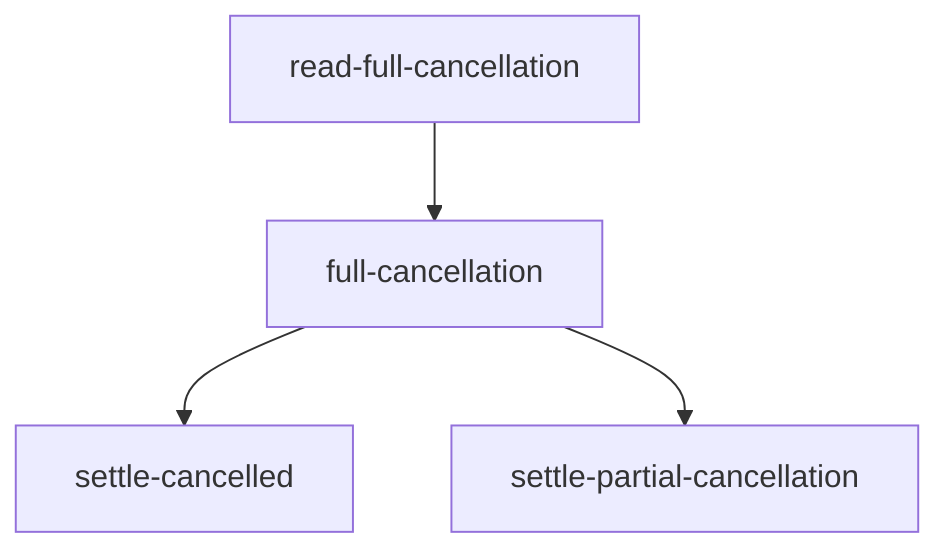

<!-- Generated by scripts/developer/flow-docs.mjs; do not edit this file. -->
# read-full-cancellation

Production/generator input SHA-256: `0e120058e4b1c4edb368f3cb91abbea2f775ad545a0887b41d8eec057a831963`. Generated from actual registered builders using FootPrintJS 12.0.0 `toMermaid()`; callbacks/providers are not run.

Chart links target checkout sources. In an installed package use developer/node with the logical `src/...` ID; its manifest resolves `dist/source/...`. Hashes/line spans bind views to source. Static diagrams are not runtime evidence or complete host semantics.

This native topology view is used by 6 registered mount instance(s). Stable local aliases remove only the actual mount prefix; the complete actual-ID mapping and contexts are in [the manifest](../../manifest.json). Shared diagrams assert matching topology only, not identical private helper semantics.

## Decisions and loops

| Stage | Branch / control | Destination |
| --- | --- | --- |
| full-cancellation | full | settle-cancelled |
| full-cancellation | partial | settle-partial-cancellation |

## Guard and hook source

| Stage | Role | Source / boundary |
| --- | --- | --- |
| read-full-cancellation | hook | [src/aftersales/runtime.ts:373](../../../../src/aftersales/runtime.ts#L373) · direct safe writes: `fullCancellation` |
| full-cancellation | decision | [src/aftersales/flowCharts.ts:95](../../../../src/aftersales/flowCharts.ts#L95) · [callback](../../../../src/aftersales/flowCharts.ts#L96) |
| full | hook | [src/aftersales/runtime.ts:374](../../../../src/aftersales/runtime.ts#L374) · helper effects require source inspection |
| partial | hook | [src/aftersales/runtime.ts:375](../../../../src/aftersales/runtime.ts#L375) · helper effects require source inspection |

[All registered flows](../../README.md)
