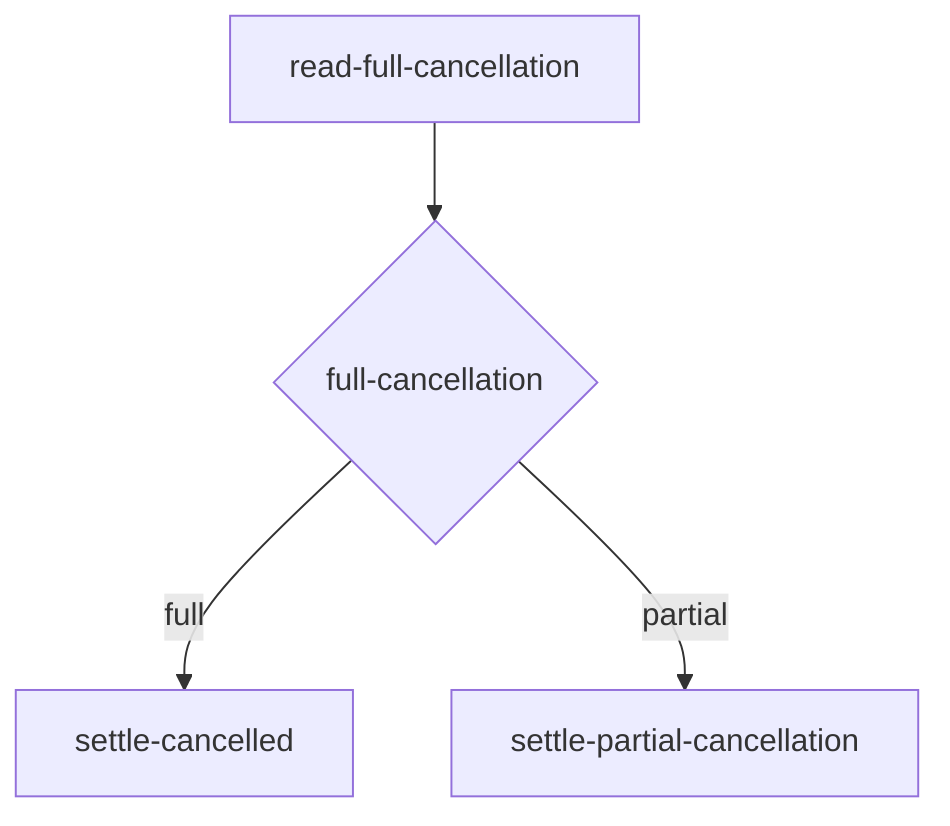

<!-- Generated by scripts/developer/flow-docs.mjs; do not edit this file. -->
# read-full-cancellation

Production/generator input SHA-256: `c3dda52a438dccdb496760bcb029b297e28aeda31e7a4a13e3462ea8aa410b27`. Actual registered builders: FootPrintJS 12.0.0 `toMermaid()` topology plus native control metadata; callbacks/providers are not run.

Chart links target checkout sources. In an installed package use developer/node with the logical `src/...` ID; its manifest resolves `dist/source/...`. Hashes/line spans bind views to source. Static diagrams are not runtime evidence or complete host semantics.

Native SDK topology with metadata-bound annotations: diamonds are actual decisions/selectors; double-sided boxes are subflows; hexagons are parallel forks; branch arrows show actual keys. Dashed “after selected/parallel branches” arrows are continuations after those branches complete, not bypass paths. Loop arrows are native back-edges. Callback exceptions, breaks, private predicates and host effects are not simulated; nested mounts open separate views.

This native topology view is used by 6 registered mount instance(s). Stable local aliases remove only the actual mount prefix; the complete actual-ID mapping, raw SDK text and edge-multiset proof are in [the manifest](../../manifest.json). Shared diagrams assert matching topology only, not identical private helper semantics.

## Decisions and loops

| Stage | Branch / control | Destination |
| --- | --- | --- |
| full-cancellation | full | settle-cancelled |
| full-cancellation | partial | settle-partial-cancellation |

## Guard and hook source

| Stage | Role | Source / boundary |
| --- | --- | --- |
| read-full-cancellation | hook | [src/aftersales/runtime.ts:373](../../../../src/aftersales/runtime.ts#L373) · direct safe writes: `fullCancellation` |
| full-cancellation | decision | [src/aftersales/flowCharts.ts:95](../../../../src/aftersales/flowCharts.ts#L95) · [callback](../../../../src/aftersales/flowCharts.ts#L96) |
| full | hook | [src/aftersales/runtime.ts:374](../../../../src/aftersales/runtime.ts#L374) · helper effects require source inspection |
| partial | hook | [src/aftersales/runtime.ts:375](../../../../src/aftersales/runtime.ts#L375) · helper effects require source inspection |

[All registered flows](../../README.md)
