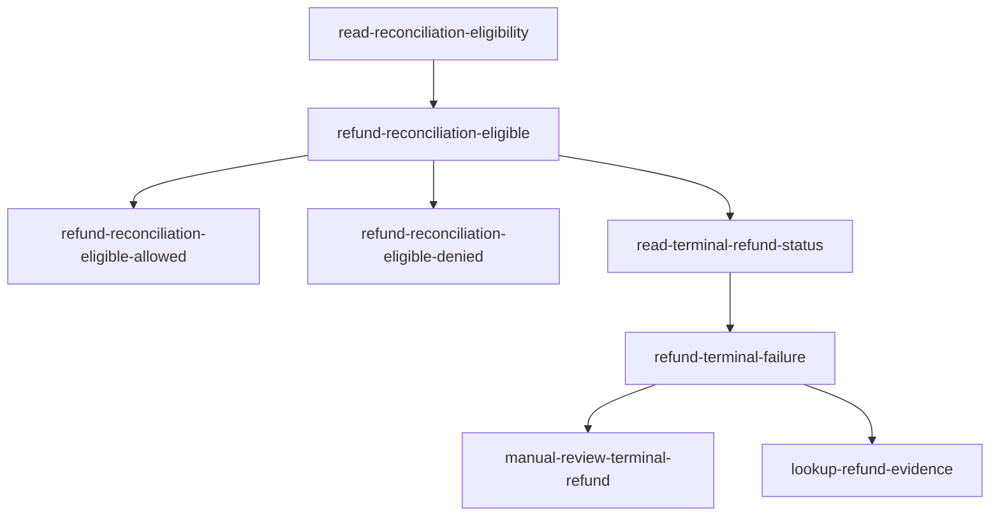

<!-- Generated by scripts/developer/flow-docs.mjs; do not edit this file. -->
# read-reconciliation-eligibility

Production/generator input SHA-256: `0e120058e4b1c4edb368f3cb91abbea2f775ad545a0887b41d8eec057a831963`. Generated from actual registered builders using FootPrintJS 12.0.0 `toMermaid()`; callbacks/providers are not run.

Chart links target checkout sources. In an installed package use developer/node with the logical `src/...` ID; its manifest resolves `dist/source/...`. Hashes/line spans bind views to source. Static diagrams are not runtime evidence or complete host semantics.

This native topology view is used by 2 registered mount instance(s). Stable local aliases remove only the actual mount prefix; the complete actual-ID mapping and contexts are in [the manifest](../../manifest.json). Shared diagrams assert matching topology only, not identical private helper semantics.

## Decisions and loops

| Stage | Branch / control | Destination |
| --- | --- | --- |
| refund-reconciliation-eligible | refund-reconciliation-eligible-allowed | refund-reconciliation-eligible-allowed |
| refund-reconciliation-eligible | refund-reconciliation-eligible-denied | refund-reconciliation-eligible-denied |
| refund-terminal-failure | failed | manual-review-terminal-refund |
| refund-terminal-failure | lookup | lookup-refund-evidence |

## Open a subflow

| Mount | Native subflow view | Mapping declarations |
| --- | --- | --- |
| lookup | [lookup-refund-evidence](../load-reconciliation-order-d27b1994333b/README.md) | inputMapper, outputMapper |

## Guard and hook source

| Stage | Role | Source / boundary |
| --- | --- | --- |
| read-reconciliation-eligibility | hook | [src/aftersales/runtime.ts:345](../../../../src/aftersales/runtime.ts#L345) · direct safe writes: `reconciliationEligible` |
| refund-reconciliation-eligible | decision | [src/aftersales/flowCharts.ts:142](../../../../src/aftersales/flowCharts.ts#L142) · safe fact `reconciliationEligible` · [guard helper](../../../../src/aftersales/flowCharts.ts#L39) |
| refund-reconciliation-eligible-denied | hook | [src/aftersales/runtime.ts:204](../../../../src/aftersales/runtime.ts#L204) · helper effects require source inspection |
| read-terminal-refund-status | hook | [src/aftersales/runtime.ts:346](../../../../src/aftersales/runtime.ts#L346) · direct safe writes: `terminalRefundFailure` |
| refund-terminal-failure | decision | [src/aftersales/flowCharts.ts:142](../../../../src/aftersales/flowCharts.ts#L142) · [callback](../../../../src/aftersales/flowCharts.ts#L144) |
| failed | hook | [src/aftersales/runtime.ts:347](../../../../src/aftersales/runtime.ts#L347) · direct safe writes: `outcome` |

[All registered flows](../../README.md)
