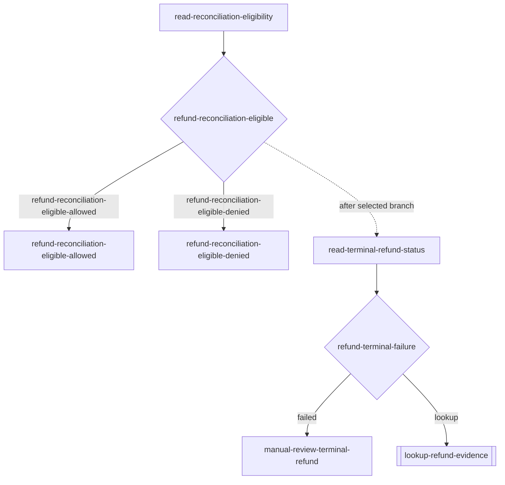

<!-- Generated by scripts/developer/flow-docs.mjs; do not edit this file. -->
# read-reconciliation-eligibility

Production/generator input SHA-256: `54ba490387d9ff380883910fbc0d35f5972f48e24193d35e980959ef15ed7649`. Actual registered builders: FootPrintJS 12.0.0 `toMermaid()` topology plus native control metadata; callbacks/providers are not run.

Chart links target checkout sources. In an installed package use developer/node with the logical `src/...` ID; its manifest resolves `dist/source/...`. Hashes/line spans bind views to source. Static diagrams are not runtime evidence or complete host semantics.

Native SDK topology with metadata-bound annotations: diamonds are actual decisions/selectors; double-sided boxes are subflows; hexagons are parallel forks; branch arrows show actual keys. Dashed “after selected/parallel branches” arrows are continuations after those branches complete, not bypass paths. Loop arrows are native back-edges. Callback exceptions, breaks, private predicates and host effects are not simulated; nested mounts open separate views.

This native topology view is used by 2 registered mount instance(s). Stable local aliases remove only the actual mount prefix; the complete actual-ID mapping, raw SDK text and edge-multiset proof are in [the manifest](../../manifest.json). Shared diagrams assert matching topology only, not identical private helper semantics.

## Algorithm

Generated from actual native stage labels and edges. Branch callbacks and host effects are not inferred. Numbering is a node inventory, not an execution trace.

1. Stage read-reconciliation-eligibility [read-reconciliation-eligibility]. Continuation: refund-reconciliation-eligible.
2. Decision refund-reconciliation-eligible [refund-reconciliation-eligible]. Branches: refund-reconciliation-eligible-allowed → refund-reconciliation-eligible-allowed; refund-reconciliation-eligible-denied → refund-reconciliation-eligible-denied. Continuation: read-terminal-refund-status.
3. Stage refund-reconciliation-eligible-allowed [refund-reconciliation-eligible-allowed]. Continuation: end of this local path.
4. Stage refund-reconciliation-eligible-denied [refund-reconciliation-eligible-denied]. Continuation: end of this local path.
5. Stage read-terminal-refund-status [read-terminal-refund-status]. Continuation: refund-terminal-failure.
6. Decision refund-terminal-failure [refund-terminal-failure]. Branches: failed → failed; lookup → lookup. Continuation: end of this local path.
7. Stage manual-review-terminal-refund [failed]. Continuation: end of this local path.
8. Subflow lookup-refund-evidence [lookup]. Open its linked child view; Continuation: end of this local path.

## Decisions and loops

| Stage | Branch / control | Destination |
| --- | --- | --- |
| refund-reconciliation-eligible | refund-reconciliation-eligible-allowed | refund-reconciliation-eligible-allowed |
| refund-reconciliation-eligible | refund-reconciliation-eligible-denied | refund-reconciliation-eligible-denied |
| refund-terminal-failure | failed | manual-review-terminal-refund |
| refund-terminal-failure | lookup | lookup-refund-evidence |

## Open a subflow

| Mount | Native subflow view | Mapping declarations |
| --- | --- | --- |
| lookup | [lookup-refund-evidence](../load-reconciliation-order-12227388301f/README.md) | inputMapper, outputMapper |

## Guard and hook source

| Stage | Role | Source / boundary |
| --- | --- | --- |
| read-reconciliation-eligibility | hook | [src/aftersales/runtime.ts:345](../../../../src/aftersales/runtime.ts#L345) · direct safe writes: `reconciliationEligible` |
| refund-reconciliation-eligible | decision | [src/aftersales/flowCharts.ts:142](../../../../src/aftersales/flowCharts.ts#L142) · safe fact `reconciliationEligible` · [guard helper](../../../../src/aftersales/flowCharts.ts#L39) |
| refund-reconciliation-eligible-denied | hook | [src/aftersales/runtime.ts:204](../../../../src/aftersales/runtime.ts#L204) · helper effects require source inspection |
| read-terminal-refund-status | hook | [src/aftersales/runtime.ts:346](../../../../src/aftersales/runtime.ts#L346) · direct safe writes: `terminalRefundFailure` |
| refund-terminal-failure | decision | [src/aftersales/flowCharts.ts:142](../../../../src/aftersales/flowCharts.ts#L142) · [callback](../../../../src/aftersales/flowCharts.ts#L144) |
| failed | hook | [src/aftersales/runtime.ts:347](../../../../src/aftersales/runtime.ts#L347) · direct safe writes: `outcome` |

[All registered flows](../../README.md)
