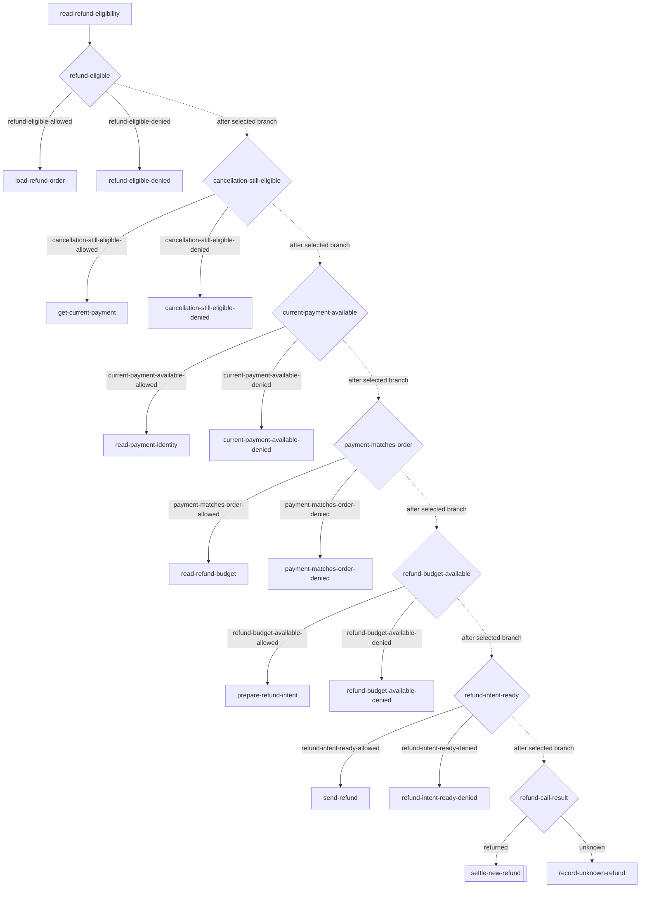

<!-- Generated by scripts/developer/flow-docs.mjs; do not edit this file. -->
# read-refund-eligibility

Production/generator input SHA-256: `c3dda52a438dccdb496760bcb029b297e28aeda31e7a4a13e3462ea8aa410b27`. Actual registered builders: FootPrintJS 12.0.0 `toMermaid()` topology plus native control metadata; callbacks/providers are not run.

Chart links target checkout sources. In an installed package use developer/node with the logical `src/...` ID; its manifest resolves `dist/source/...`. Hashes/line spans bind views to source. Static diagrams are not runtime evidence or complete host semantics.

Native SDK topology with metadata-bound annotations: diamonds are actual decisions/selectors; double-sided boxes are subflows; hexagons are parallel forks; branch arrows show actual keys. Dashed “after selected/parallel branches” arrows are continuations after those branches complete, not bypass paths. Loop arrows are native back-edges. Callback exceptions, breaks, private predicates and host effects are not simulated; nested mounts open separate views.

This native topology view is used by 1 registered mount instance(s). Stable local aliases remove only the actual mount prefix; the complete actual-ID mapping, raw SDK text and edge-multiset proof are in [the manifest](../../manifest.json). Shared diagrams assert matching topology only, not identical private helper semantics.

## Decisions and loops

| Stage | Branch / control | Destination |
| --- | --- | --- |
| refund-eligible | refund-eligible-allowed | load-refund-order |
| refund-eligible | refund-eligible-denied | refund-eligible-denied |
| cancellation-still-eligible | cancellation-still-eligible-allowed | get-current-payment |
| cancellation-still-eligible | cancellation-still-eligible-denied | cancellation-still-eligible-denied |
| current-payment-available | current-payment-available-allowed | read-payment-identity |
| current-payment-available | current-payment-available-denied | current-payment-available-denied |
| payment-matches-order | payment-matches-order-allowed | read-refund-budget |
| payment-matches-order | payment-matches-order-denied | payment-matches-order-denied |
| refund-budget-available | refund-budget-available-allowed | prepare-refund-intent |
| refund-budget-available | refund-budget-available-denied | refund-budget-available-denied |
| refund-intent-ready | refund-intent-ready-allowed | send-refund |
| refund-intent-ready | refund-intent-ready-denied | refund-intent-ready-denied |
| refund-call-result | returned | settle-new-refund |
| refund-call-result | unknown | record-unknown-refund |

## Open a subflow

| Mount | Native subflow view | Mapping declarations |
| --- | --- | --- |
| returned | [settle-new-refund](../validate-refund-evidence-5eb6ea741bb4/README.md) | inputMapper, outputMapper |

## Guard and hook source

| Stage | Role | Source / boundary |
| --- | --- | --- |
| read-refund-eligibility | hook | [src/aftersales/runtime.ts:314](../../../../src/aftersales/runtime.ts#L314) · direct safe writes: `refundEligible` |
| refund-eligible | decision | [src/aftersales/flowCharts.ts:150](../../../../src/aftersales/flowCharts.ts#L150) · safe fact `refundEligible` · [guard helper](../../../../src/aftersales/flowCharts.ts#L45) |
| refund-eligible-allowed | hook | [src/aftersales/runtime.ts:317](../../../../src/aftersales/runtime.ts#L317) · direct safe writes: `cancellationStillEligible` |
| refund-eligible-denied | hook | [src/aftersales/runtime.ts:204](../../../../src/aftersales/runtime.ts#L204) · helper effects require source inspection |
| cancellation-still-eligible | decision | [src/aftersales/flowCharts.ts:151](../../../../src/aftersales/flowCharts.ts#L151) · safe fact `cancellationStillEligible` · [guard helper](../../../../src/aftersales/flowCharts.ts#L45) |
| cancellation-still-eligible-allowed | hook | [src/aftersales/runtime.ts:318](../../../../src/aftersales/runtime.ts#L318) · direct safe writes: `paymentAvailable` · opaque payments.getPayment |
| cancellation-still-eligible-denied | hook | [src/aftersales/runtime.ts:204](../../../../src/aftersales/runtime.ts#L204) · helper effects require source inspection |
| current-payment-available | decision | [src/aftersales/flowCharts.ts:152](../../../../src/aftersales/flowCharts.ts#L152) · safe fact `paymentAvailable` · [guard helper](../../../../src/aftersales/flowCharts.ts#L45) |
| current-payment-available-allowed | hook | [src/aftersales/runtime.ts:322](../../../../src/aftersales/runtime.ts#L322) · direct safe writes: `paymentMatchesOrder` |
| current-payment-available-denied | hook | [src/aftersales/runtime.ts:205](../../../../src/aftersales/runtime.ts#L205) · helper effects require source inspection |
| payment-matches-order | decision | [src/aftersales/flowCharts.ts:153](../../../../src/aftersales/flowCharts.ts#L153) · safe fact `paymentMatchesOrder` · [guard helper](../../../../src/aftersales/flowCharts.ts#L45) |
| payment-matches-order-allowed | hook | [src/aftersales/runtime.ts:323](../../../../src/aftersales/runtime.ts#L323) · direct safe writes: `refundBudgetAvailable` |
| payment-matches-order-denied | hook | [src/aftersales/runtime.ts:204](../../../../src/aftersales/runtime.ts#L204) · helper effects require source inspection |
| refund-budget-available | decision | [src/aftersales/flowCharts.ts:154](../../../../src/aftersales/flowCharts.ts#L154) · safe fact `refundBudgetAvailable` · [guard helper](../../../../src/aftersales/flowCharts.ts#L45) |
| refund-budget-available-allowed | hook | [src/aftersales/runtime.ts:326](../../../../src/aftersales/runtime.ts#L326) · direct safe writes: `refundPrepared` · opaque repository.prepareRefund |
| refund-budget-available-denied | hook | [src/aftersales/runtime.ts:204](../../../../src/aftersales/runtime.ts#L204) · helper effects require source inspection |
| refund-intent-ready | decision | [src/aftersales/flowCharts.ts:155](../../../../src/aftersales/flowCharts.ts#L155) · safe fact `refundPrepared` · [guard helper](../../../../src/aftersales/flowCharts.ts#L45) |
| refund-intent-ready-allowed | hook | [src/aftersales/runtime.ts:334](../../../../src/aftersales/runtime.ts#L334) · direct safe writes: `refundCallReturned` · opaque payments.refund |
| refund-intent-ready-denied | hook | [src/aftersales/runtime.ts:204](../../../../src/aftersales/runtime.ts#L204) · helper effects require source inspection |
| refund-call-result | decision | [src/aftersales/flowCharts.ts:155](../../../../src/aftersales/flowCharts.ts#L155) · [callback](../../../../src/aftersales/flowCharts.ts#L156) |
| unknown | hook | [src/aftersales/runtime.ts:340](../../../../src/aftersales/runtime.ts#L340) · direct safe writes: `outcome` · opaque repository.completeRefund |

[All registered flows](../../README.md)
