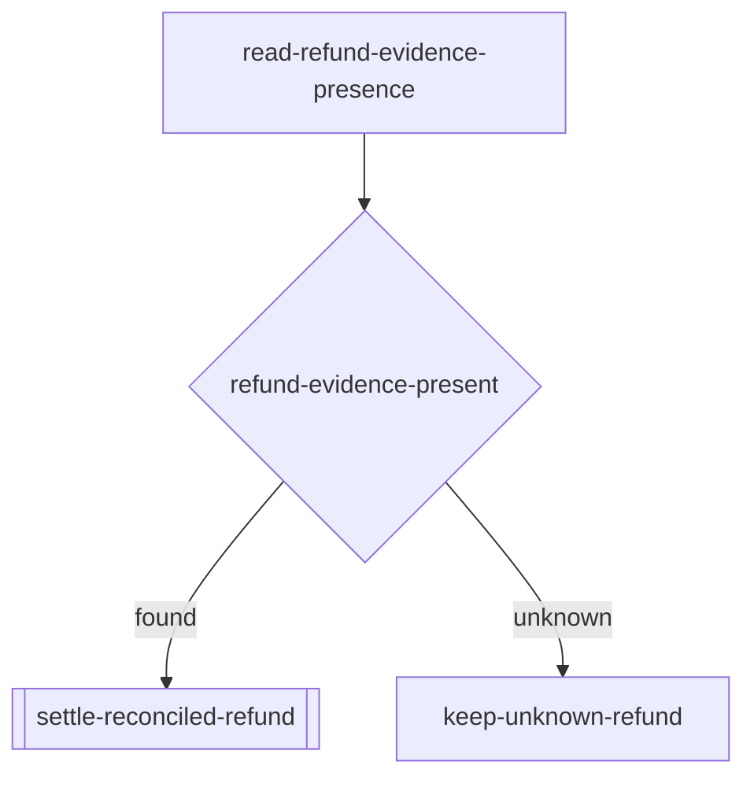

<!-- Generated by scripts/developer/flow-docs.mjs; do not edit this file. -->
# read-refund-evidence-presence

Production/generator input SHA-256: `cad5181e473e3001f6b55752f12d9f9509786436f2743080765e0238b3e43dde`. Actual registered builders: FootPrintJS 12.0.0 `toMermaid()` topology plus native control metadata; callbacks/providers are not run.

Chart links target checkout sources. In an installed package use developer/node with the logical `src/...` ID; its manifest resolves `dist/source/...`. Hashes/line spans bind views to source. Static diagrams are not runtime evidence or complete host semantics.

Native SDK topology with metadata-bound annotations: diamonds are actual decisions/selectors; double-sided boxes are subflows; hexagons are parallel forks; branch arrows show actual keys. Dashed “after selected/parallel branches” arrows are continuations after those branches complete, not bypass paths. Loop arrows are native back-edges. Callback exceptions, breaks, private predicates and host effects are not simulated; nested mounts open separate views.

This native topology view is used by 2 registered mount instance(s). Stable local aliases remove only the actual mount prefix; the complete actual-ID mapping, raw SDK text and edge-multiset proof are in [the manifest](../../manifest.json). Shared diagrams assert matching topology only, not identical private helper semantics.

## Decisions and loops

| Stage | Branch / control | Destination |
| --- | --- | --- |
| refund-evidence-present | found | settle-reconciled-refund |
| refund-evidence-present | unknown | keep-unknown-refund |

## Open a subflow

| Mount | Native subflow view | Mapping declarations |
| --- | --- | --- |
| found | [settle-reconciled-refund](../record-authoritative-reconciliation-c12c6b46b5bf/README.md) | inputMapper, outputMapper |

## Guard and hook source

| Stage | Role | Source / boundary |
| --- | --- | --- |
| read-refund-evidence-presence | hook | [src/aftersales/runtime.ts:359](../../../../src/aftersales/runtime.ts#L359) · direct safe writes: `evidencePresent` |
| refund-evidence-present | decision | [src/aftersales/flowCharts.ts:129](../../../../src/aftersales/flowCharts.ts#L129) · [callback](../../../../src/aftersales/flowCharts.ts#L130) |
| unknown | hook | [src/aftersales/runtime.ts:361](../../../../src/aftersales/runtime.ts#L361) · direct safe writes: `outcome` |

[All registered flows](../../README.md)
