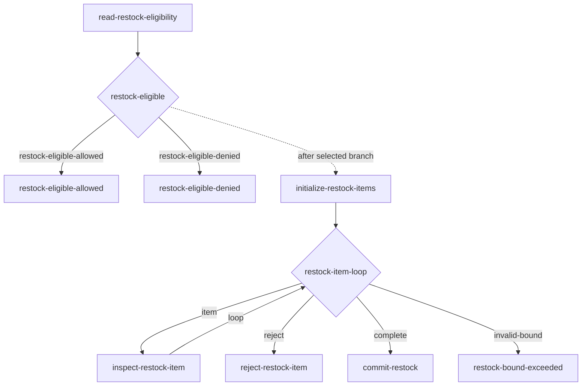

<!-- Generated by scripts/developer/flow-docs.mjs; do not edit this file. -->
# read-restock-eligibility

Production/generator input SHA-256: `cad5181e473e3001f6b55752f12d9f9509786436f2743080765e0238b3e43dde`. Actual registered builders: FootPrintJS 12.0.0 `toMermaid()` topology plus native control metadata; callbacks/providers are not run.

Chart links target checkout sources. In an installed package use developer/node with the logical `src/...` ID; its manifest resolves `dist/source/...`. Hashes/line spans bind views to source. Static diagrams are not runtime evidence or complete host semantics.

Native SDK topology with metadata-bound annotations: diamonds are actual decisions/selectors; double-sided boxes are subflows; hexagons are parallel forks; branch arrows show actual keys. Dashed “after selected/parallel branches” arrows are continuations after those branches complete, not bypass paths. Loop arrows are native back-edges. Callback exceptions, breaks, private predicates and host effects are not simulated; nested mounts open separate views.

This native topology view is used by 9 registered mount instance(s). Stable local aliases remove only the actual mount prefix; the complete actual-ID mapping, raw SDK text and edge-multiset proof are in [the manifest](../../manifest.json). Shared diagrams assert matching topology only, not identical private helper semantics.

## Decisions and loops

| Stage | Branch / control | Destination |
| --- | --- | --- |
| restock-eligible | restock-eligible-allowed | restock-eligible-allowed |
| restock-eligible | restock-eligible-denied | restock-eligible-denied |
| restock-item-loop | item | inspect-restock-item |
| restock-item-loop | reject | reject-restock-item |
| restock-item-loop | complete | commit-restock |
| restock-item-loop | invalid-bound | restock-bound-exceeded |
| item | loop back-edge | restock-item-loop |

## Guard and hook source

| Stage | Role | Source / boundary |
| --- | --- | --- |
| read-restock-eligibility | hook | [src/aftersales/runtime.ts:381](../../../../src/aftersales/runtime.ts#L381) · direct safe writes: `restockEligible` |
| restock-eligible | decision | [src/aftersales/flowCharts.ts:80](../../../../src/aftersales/flowCharts.ts#L80) · safe fact `restockEligible` · [guard helper](../../../../src/aftersales/flowCharts.ts#L39) |
| restock-eligible-denied | hook | [src/aftersales/runtime.ts:204](../../../../src/aftersales/runtime.ts#L204) · helper effects require source inspection |
| initialize-restock-items | hook | [src/aftersales/runtime.ts:382](../../../../src/aftersales/runtime.ts#L382) · direct safe writes: `restockCount`, `restockIndex` |
| restock-item-loop | decision | [src/aftersales/flowCharts.ts:80](../../../../src/aftersales/flowCharts.ts#L80) · [callback](../../../../src/aftersales/flowCharts.ts#L82) |
| item | hook | [src/aftersales/runtime.ts:383](../../../../src/aftersales/runtime.ts#L383) · direct safe writes: `restockIndex`, `restockLineCheck`, `restockLineEligible` |
| reject | hook | [src/aftersales/runtime.ts:204](../../../../src/aftersales/runtime.ts#L204) · helper effects require source inspection |
| complete | hook | [src/aftersales/runtime.ts:389](../../../../src/aftersales/runtime.ts#L389) · direct safe writes: `outcome` · opaque repository.restock |
| invalid-bound | hook | [src/aftersales/runtime.ts:204](../../../../src/aftersales/runtime.ts#L204) · helper effects require source inspection |

[All registered flows](../../README.md)
