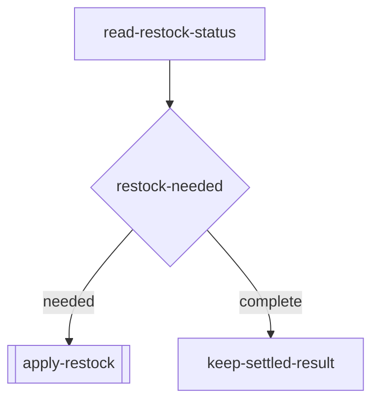

<!-- Generated by scripts/developer/flow-docs.mjs; do not edit this file. -->
# read-restock-status

Production/generator input SHA-256: `54ba490387d9ff380883910fbc0d35f5972f48e24193d35e980959ef15ed7649`. Actual registered builders: FootPrintJS 12.0.0 `toMermaid()` topology plus native control metadata; callbacks/providers are not run.

Chart links target checkout sources. In an installed package use developer/node with the logical `src/...` ID; its manifest resolves `dist/source/...`. Hashes/line spans bind views to source. Static diagrams are not runtime evidence or complete host semantics.

Native SDK topology with metadata-bound annotations: diamonds are actual decisions/selectors; double-sided boxes are subflows; hexagons are parallel forks; branch arrows show actual keys. Dashed “after selected/parallel branches” arrows are continuations after those branches complete, not bypass paths. Loop arrows are native back-edges. Callback exceptions, breaks, private predicates and host effects are not simulated; nested mounts open separate views.

This native topology view is used by 9 registered mount instance(s). Stable local aliases remove only the actual mount prefix; the complete actual-ID mapping, raw SDK text and edge-multiset proof are in [the manifest](../../manifest.json). Shared diagrams assert matching topology only, not identical private helper semantics.

## Algorithm

Generated from actual native stage labels and edges. Branch callbacks and host effects are not inferred. Numbering is a node inventory, not an execution trace.

1. Stage read-restock-status [read-restock-status]. Continuation: restock-needed.
2. Decision restock-needed [restock-needed]. Branches: needed → needed; complete → complete. Continuation: end of this local path.
3. Subflow apply-restock [needed]. Open its linked child view; Continuation: end of this local path.
4. Stage keep-settled-result [complete]. Continuation: end of this local path.

## Decisions and loops

| Stage | Branch / control | Destination |
| --- | --- | --- |
| restock-needed | needed | apply-restock |
| restock-needed | complete | keep-settled-result |

## Open a subflow

| Mount | Native subflow view | Mapping declarations |
| --- | --- | --- |
| needed | [apply-restock](../read-restock-eligibility-271379f9811f/README.md) | inputMapper, outputMapper |

## Guard and hook source

| Stage | Role | Source / boundary |
| --- | --- | --- |
| read-restock-status | hook | [src/aftersales/runtime.ts:379](../../../../src/aftersales/runtime.ts#L379) · direct safe writes: `restockPending` |
| restock-needed | decision | [src/aftersales/flowCharts.ts:88](../../../../src/aftersales/flowCharts.ts#L88) · [callback](../../../../src/aftersales/flowCharts.ts#L89) |
| complete | hook | [src/aftersales/runtime.ts:380](../../../../src/aftersales/runtime.ts#L380) · direct safe writes: `outcome` |

[All registered flows](../../README.md)
