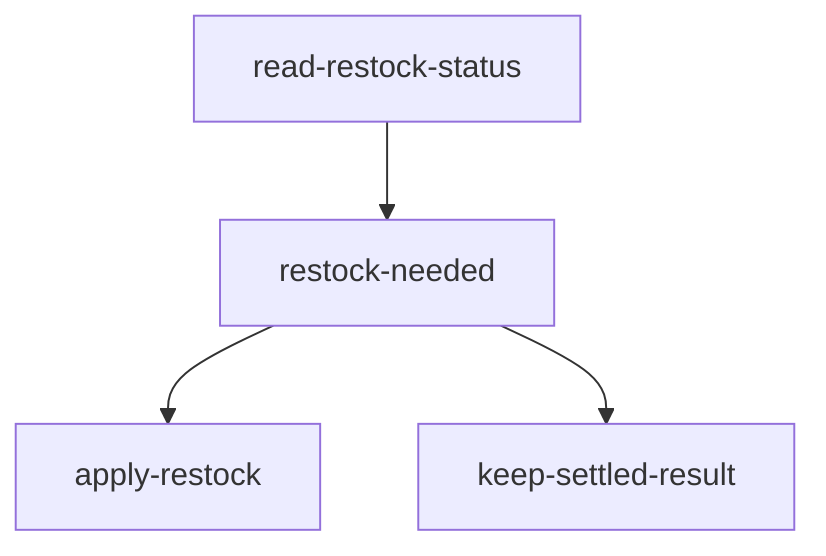

<!-- Generated by scripts/developer/flow-docs.mjs; do not edit this file. -->
# read-restock-status

Production/generator input SHA-256: `0e120058e4b1c4edb368f3cb91abbea2f775ad545a0887b41d8eec057a831963`. Generated from actual registered builders using FootPrintJS 12.0.0 `toMermaid()`; callbacks/providers are not run.

Chart links target checkout sources. In an installed package use developer/node with the logical `src/...` ID; its manifest resolves `dist/source/...`. Hashes/line spans bind views to source. Static diagrams are not runtime evidence or complete host semantics.

This native topology view is used by 9 registered mount instance(s). Stable local aliases remove only the actual mount prefix; the complete actual-ID mapping and contexts are in [the manifest](../../manifest.json). Shared diagrams assert matching topology only, not identical private helper semantics.

## Decisions and loops

| Stage | Branch / control | Destination |
| --- | --- | --- |
| restock-needed | needed | apply-restock |
| restock-needed | complete | keep-settled-result |

## Open a subflow

| Mount | Native subflow view | Mapping declarations |
| --- | --- | --- |
| needed | [apply-restock](../read-restock-eligibility-c4abafcbe261/README.md) | inputMapper, outputMapper |

## Guard and hook source

| Stage | Role | Source / boundary |
| --- | --- | --- |
| read-restock-status | hook | [src/aftersales/runtime.ts:379](../../../../src/aftersales/runtime.ts#L379) · direct safe writes: `restockPending` |
| restock-needed | decision | [src/aftersales/flowCharts.ts:88](../../../../src/aftersales/flowCharts.ts#L88) · [callback](../../../../src/aftersales/flowCharts.ts#L89) |
| complete | hook | [src/aftersales/runtime.ts:380](../../../../src/aftersales/runtime.ts#L380) · direct safe writes: `outcome` |

[All registered flows](../../README.md)
