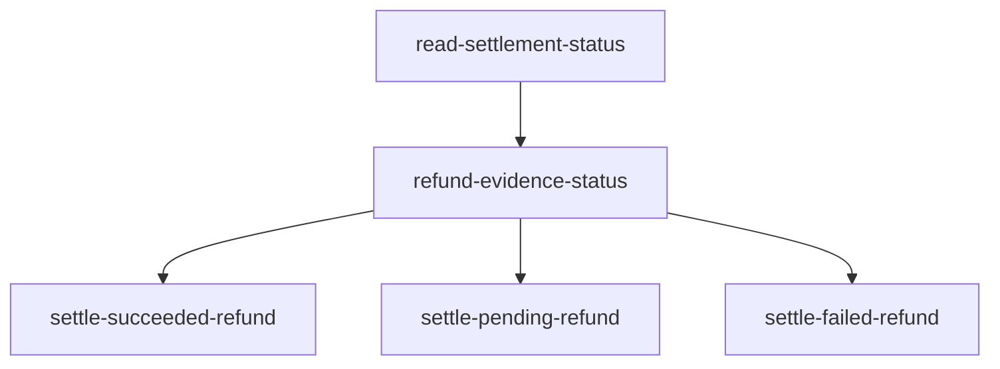

<!-- Generated by scripts/developer/flow-docs.mjs; do not edit this file. -->
# read-settlement-status

Production/generator input SHA-256: `0e120058e4b1c4edb368f3cb91abbea2f775ad545a0887b41d8eec057a831963`. Generated from actual registered builders using FootPrintJS 12.0.0 `toMermaid()`; callbacks/providers are not run.

Chart links target checkout sources. In an installed package use developer/node with the logical `src/...` ID; its manifest resolves `dist/source/...`. Hashes/line spans bind views to source. Static diagrams are not runtime evidence or complete host semantics.

This native topology view is used by 6 registered mount instance(s). Stable local aliases remove only the actual mount prefix; the complete actual-ID mapping and contexts are in [the manifest](../../manifest.json). Shared diagrams assert matching topology only, not identical private helper semantics.

## Decisions and loops

| Stage | Branch / control | Destination |
| --- | --- | --- |
| refund-evidence-status | succeeded | settle-succeeded-refund |
| refund-evidence-status | pending | settle-pending-refund |
| refund-evidence-status | failed | settle-failed-refund |

## Open a subflow

| Mount | Native subflow view | Mapping declarations |
| --- | --- | --- |
| succeeded | [settle-succeeded-refund](../read-cancellation-disposition-b82078418116/README.md) | inputMapper, outputMapper |

## Guard and hook source

| Stage | Role | Source / boundary |
| --- | --- | --- |
| read-settlement-status | hook | [src/aftersales/runtime.ts:371](../../../../src/aftersales/runtime.ts#L371) · direct safe writes: `evidenceStatus` |
| refund-evidence-status | decision | [src/aftersales/flowCharts.ts:105](../../../../src/aftersales/flowCharts.ts#L105) · [callback](../../../../src/aftersales/flowCharts.ts#L106) |
| pending | hook | [src/aftersales/runtime.ts:377](../../../../src/aftersales/runtime.ts#L377) · helper effects require source inspection |
| failed | hook | [src/aftersales/runtime.ts:378](../../../../src/aftersales/runtime.ts#L378) · helper effects require source inspection |

[All registered flows](../../README.md)
