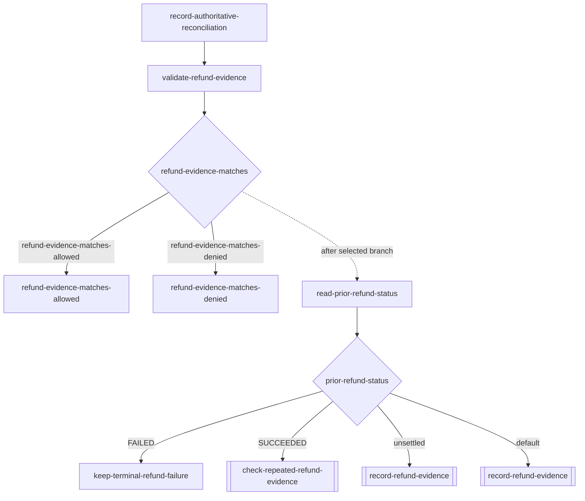

<!-- Generated by scripts/developer/flow-docs.mjs; do not edit this file. -->
# record-authoritative-reconciliation

Production/generator input SHA-256: `13517c9c684a32e0c2c721ce13e169b03e23eecc32e8fc99366938a759fd3439`. Actual registered builders: FootPrintJS 12.0.0 `toMermaid()` topology plus native control metadata; callbacks/providers are not run.

Chart links target checkout sources. In an installed package use developer/node with the logical `src/...` ID; its manifest resolves `dist/source/...`. Hashes/line spans bind views to source. Static diagrams are not runtime evidence or complete host semantics.

Native SDK topology with metadata-bound annotations: diamonds are actual decisions/selectors; double-sided boxes are subflows; hexagons are parallel forks; branch arrows show actual keys. Dashed “after selected/parallel branches” arrows are continuations after those branches complete, not bypass paths. Loop arrows are native back-edges. Callback exceptions, breaks, private predicates and host effects are not simulated; nested mounts open separate views.

This native topology view is used by 2 registered mount instance(s). Stable local aliases remove only the actual mount prefix; the complete actual-ID mapping, raw SDK text and edge-multiset proof are in [the manifest](../../manifest.json). Shared diagrams assert matching topology only, not identical private helper semantics.

## Algorithm

Generated from actual native stage labels and edges. Branch callbacks and host effects are not inferred. Numbering is a node inventory, not an execution trace.

1. Stage record-authoritative-reconciliation [record-authoritative-reconciliation]. Continuation: validate-refund-evidence.
2. Stage validate-refund-evidence [validate-refund-evidence]. Continuation: refund-evidence-matches.
3. Decision refund-evidence-matches [refund-evidence-matches]. Branches: refund-evidence-matches-allowed → refund-evidence-matches-allowed; refund-evidence-matches-denied → refund-evidence-matches-denied. Continuation: read-prior-refund-status.
4. Stage refund-evidence-matches-allowed [refund-evidence-matches-allowed]. Continuation: end of this local path.
5. Stage refund-evidence-matches-denied [refund-evidence-matches-denied]. Continuation: end of this local path.
6. Stage read-prior-refund-status [read-prior-refund-status]. Continuation: prior-refund-status.
7. Decision prior-refund-status [prior-refund-status]. Branches: FAILED → FAILED; SUCCEEDED → SUCCEEDED; unsettled → unsettled; default → default. Continuation: end of this local path.
8. Stage keep-terminal-refund-failure [FAILED]. Continuation: end of this local path.
9. Subflow check-repeated-refund-evidence [SUCCEEDED]. Open its linked child view; Continuation: end of this local path.
10. Subflow record-refund-evidence [unsettled]. Open its linked child view; Continuation: end of this local path.
11. Subflow record-refund-evidence [default]. Open its linked child view; Continuation: end of this local path.

## Decisions and loops

| Stage | Branch / control | Destination |
| --- | --- | --- |
| refund-evidence-matches | refund-evidence-matches-allowed | refund-evidence-matches-allowed |
| refund-evidence-matches | refund-evidence-matches-denied | refund-evidence-matches-denied |
| prior-refund-status | FAILED | keep-terminal-refund-failure |
| prior-refund-status | SUCCEEDED | check-repeated-refund-evidence |
| prior-refund-status | unsettled | record-refund-evidence |
| prior-refund-status | default | record-refund-evidence |

## Open a subflow

| Mount | Native subflow view | Mapping declarations |
| --- | --- | --- |
| SUCCEEDED | [check-repeated-refund-evidence](../read-settlement-status-3aa90787446a/README.md) | inputMapper, outputMapper |
| unsettled | [record-refund-evidence](../read-settlement-status-388fd1ef688f/README.md) | inputMapper, outputMapper |
| default | [record-refund-evidence](../read-settlement-status-388fd1ef688f/README.md) | inputMapper, outputMapper |

## Guard and hook source

| Stage | Role | Source / boundary |
| --- | --- | --- |
| record-authoritative-reconciliation | hook | [src/aftersales/runtime.ts:360](../../../../src/aftersales/runtime.ts#L360) · helper effects require source inspection |
| validate-refund-evidence | hook | [src/aftersales/runtime.ts:363](../../../../src/aftersales/runtime.ts#L363) · direct safe writes: `evidenceMatches` |
| refund-evidence-matches | decision | [src/aftersales/flowCharts.ts:120](../../../../src/aftersales/flowCharts.ts#L120) · safe fact `evidenceMatches` · [guard helper](../../../../src/aftersales/flowCharts.ts#L39) |
| refund-evidence-matches-denied | hook | [src/aftersales/runtime.ts:205](../../../../src/aftersales/runtime.ts#L205) · helper effects require source inspection |
| read-prior-refund-status | hook | [src/aftersales/runtime.ts:370](../../../../src/aftersales/runtime.ts#L370) · direct safe writes: `priorRefundStatus` |
| prior-refund-status | decision | [src/aftersales/flowCharts.ts:120](../../../../src/aftersales/flowCharts.ts#L120) · [callback](../../../../src/aftersales/flowCharts.ts#L122) |
| FAILED | hook | [src/aftersales/runtime.ts:380](../../../../src/aftersales/runtime.ts#L380) · direct safe writes: `outcome` |

[All registered flows](../../README.md)
