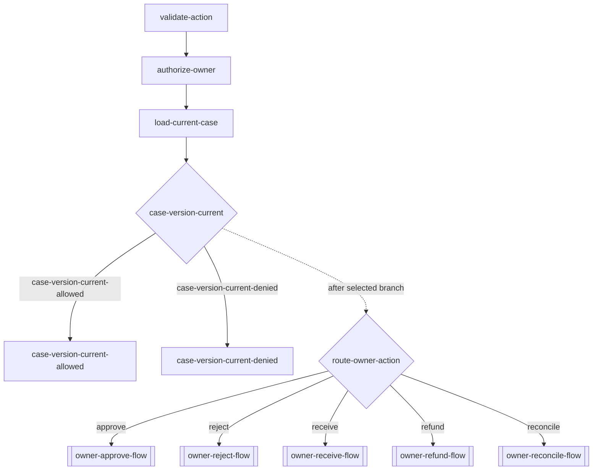

<!-- Generated by scripts/developer/flow-docs.mjs; do not edit this file. -->
# validate-action

Production/generator input SHA-256: `54ba490387d9ff380883910fbc0d35f5972f48e24193d35e980959ef15ed7649`. Actual registered builders: FootPrintJS 12.0.0 `toMermaid()` topology plus native control metadata; callbacks/providers are not run.

Chart links target checkout sources. In an installed package use developer/node with the logical `src/...` ID; its manifest resolves `dist/source/...`. Hashes/line spans bind views to source. Static diagrams are not runtime evidence or complete host semantics.

Native SDK topology with metadata-bound annotations: diamonds are actual decisions/selectors; double-sided boxes are subflows; hexagons are parallel forks; branch arrows show actual keys. Dashed “after selected/parallel branches” arrows are continuations after those branches complete, not bypass paths. Loop arrows are native back-edges. Callback exceptions, breaks, private predicates and host effects are not simulated; nested mounts open separate views.

This native topology view is used by 1 registered mount instance(s). Stable local aliases remove only the actual mount prefix; the complete actual-ID mapping, raw SDK text and edge-multiset proof are in [the manifest](../../manifest.json). Shared diagrams assert matching topology only, not identical private helper semantics.

## Algorithm

Generated from actual native stage labels and edges. Branch callbacks and host effects are not inferred. Numbering is a node inventory, not an execution trace.

1. Stage validate-action [validate-action]. Continuation: authorize-owner.
2. Stage authorize-owner [authorize-owner]. Continuation: load-current-case.
3. Stage load-current-case [load-current-case]. Continuation: case-version-current.
4. Decision case-version-current [case-version-current]. Branches: case-version-current-allowed → case-version-current-allowed; case-version-current-denied → case-version-current-denied. Continuation: route-owner-action.
5. Stage case-version-current-allowed [case-version-current-allowed]. Continuation: end of this local path.
6. Stage case-version-current-denied [case-version-current-denied]. Continuation: end of this local path.
7. Decision route-owner-action [route-owner-action]. Branches: approve → approve; reject → reject; receive → receive; refund → refund; reconcile → reconcile. Continuation: end of this local path.
8. Subflow owner-approve-flow [approve]. Open its linked child view; Continuation: end of this local path.
9. Subflow owner-reject-flow [reject]. Open its linked child view; Continuation: end of this local path.
10. Subflow owner-receive-flow [receive]. Open its linked child view; Continuation: end of this local path.
11. Subflow owner-refund-flow [refund]. Open its linked child view; Continuation: end of this local path.
12. Subflow owner-reconcile-flow [reconcile]. Open its linked child view; Continuation: end of this local path.

## Decisions and loops

| Stage | Branch / control | Destination |
| --- | --- | --- |
| case-version-current | case-version-current-allowed | case-version-current-allowed |
| case-version-current | case-version-current-denied | case-version-current-denied |
| route-owner-action | approve | owner-approve-flow |
| route-owner-action | reject | owner-reject-flow |
| route-owner-action | receive | owner-receive-flow |
| route-owner-action | refund | owner-refund-flow |
| route-owner-action | reconcile | owner-reconcile-flow |

## Open a subflow

| Mount | Native subflow view | Mapping declarations |
| --- | --- | --- |
| approve | [owner-approve-flow](../owner-approve-e136335ffb56/README.md) | inputMapper, outputMapper |
| reject | [owner-reject-flow](../owner-reject-b6a624cd344a/README.md) | inputMapper, outputMapper |
| receive | [owner-receive-flow](../owner-receive-aa8ce04e60f3/README.md) | inputMapper, outputMapper |
| refund | [owner-refund-flow](../owner-refund-9de3fa31913a/README.md) | inputMapper, outputMapper |
| reconcile | [owner-reconcile-flow](../owner-reconcile-1f5b5c6ce861/README.md) | inputMapper, outputMapper |

## Guard and hook source

| Stage | Role | Source / boundary |
| --- | --- | --- |
| validate-action | hook | [src/aftersales/runtime.ts:287](../../../../src/aftersales/runtime.ts#L287) · direct safe writes: `action` |
| authorize-owner | hook | [src/aftersales/runtime.ts:288](../../../../src/aftersales/runtime.ts#L288) · helper effects require source inspection |
| load-current-case | hook | [src/aftersales/runtime.ts:289](../../../../src/aftersales/runtime.ts#L289) · direct safe writes: `versionCurrent` |
| case-version-current | decision | [src/aftersales/flowCharts.ts:179](../../../../src/aftersales/flowCharts.ts#L179) · safe fact `versionCurrent` · [guard helper](../../../../src/aftersales/flowCharts.ts#L39) |
| case-version-current-denied | hook | [src/aftersales/runtime.ts:204](../../../../src/aftersales/runtime.ts#L204) · helper effects require source inspection |
| route-owner-action | decision | [src/aftersales/flowCharts.ts:179](../../../../src/aftersales/flowCharts.ts#L179) · [callback](../../../../src/aftersales/flowCharts.ts#L182) |

[All registered flows](../../README.md)
