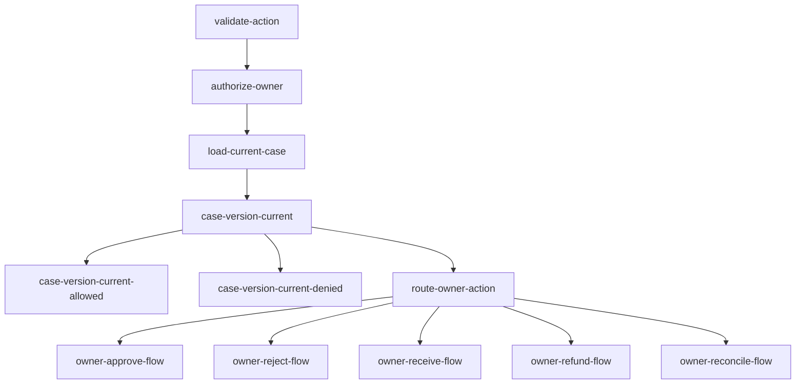

<!-- Generated by scripts/developer/flow-docs.mjs; do not edit this file. -->
# validate-action

Production/generator input SHA-256: `0e120058e4b1c4edb368f3cb91abbea2f775ad545a0887b41d8eec057a831963`. Generated from actual registered builders using FootPrintJS 12.0.0 `toMermaid()`; callbacks/providers are not run.

Chart links target checkout sources. In an installed package use developer/node with the logical `src/...` ID; its manifest resolves `dist/source/...`. Hashes/line spans bind views to source. Static diagrams are not runtime evidence or complete host semantics.

This native topology view is used by 1 registered mount instance(s). Stable local aliases remove only the actual mount prefix; the complete actual-ID mapping and contexts are in [the manifest](../../manifest.json). Shared diagrams assert matching topology only, not identical private helper semantics.

## Decisions and loops

| Stage | Branch / control | Destination |
| --- | --- | --- |
| case-version-current | case-version-current-allowed | case-version-current-allowed |
| case-version-current | case-version-current-denied | case-version-current-denied |
| route-owner-action | approve | owner-approve-flow |
| route-owner-action | reject | owner-reject-flow |
| route-owner-action | receive | owner-receive-flow |
| route-owner-action | refund | owner-refund-flow |
| route-owner-action | reconcile | owner-reconcile-flow |

## Open a subflow

| Mount | Native subflow view | Mapping declarations |
| --- | --- | --- |
| approve | [owner-approve-flow](../owner-approve-2ac56700f4e3/README.md) | inputMapper, outputMapper |
| reject | [owner-reject-flow](../owner-reject-f16df0ead3ee/README.md) | inputMapper, outputMapper |
| receive | [owner-receive-flow](../owner-receive-aad1d7d71fde/README.md) | inputMapper, outputMapper |
| refund | [owner-refund-flow](../owner-refund-154bd3c81b12/README.md) | inputMapper, outputMapper |
| reconcile | [owner-reconcile-flow](../owner-reconcile-10cab679e261/README.md) | inputMapper, outputMapper |

## Guard and hook source

| Stage | Role | Source / boundary |
| --- | --- | --- |
| validate-action | hook | [src/aftersales/runtime.ts:287](../../../../src/aftersales/runtime.ts#L287) · direct safe writes: `action` |
| authorize-owner | hook | [src/aftersales/runtime.ts:288](../../../../src/aftersales/runtime.ts#L288) · helper effects require source inspection |
| load-current-case | hook | [src/aftersales/runtime.ts:289](../../../../src/aftersales/runtime.ts#L289) · direct safe writes: `versionCurrent` |
| case-version-current | decision | [src/aftersales/flowCharts.ts:179](../../../../src/aftersales/flowCharts.ts#L179) · safe fact `versionCurrent` · [guard helper](../../../../src/aftersales/flowCharts.ts#L39) |
| case-version-current-denied | hook | [src/aftersales/runtime.ts:204](../../../../src/aftersales/runtime.ts#L204) · helper effects require source inspection |
| route-owner-action | decision | [src/aftersales/flowCharts.ts:179](../../../../src/aftersales/flowCharts.ts#L179) · [callback](../../../../src/aftersales/flowCharts.ts#L182) |

[All registered flows](../../README.md)
