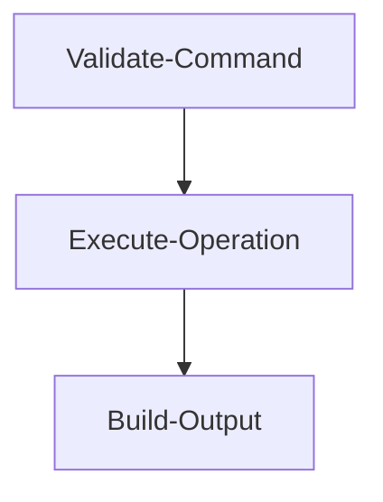

<!-- Generated by scripts/developer/flow-docs.mjs; do not edit this file. -->
# Validate-Command

Production/generator input SHA-256: `54ba490387d9ff380883910fbc0d35f5972f48e24193d35e980959ef15ed7649`. Actual registered builders: FootPrintJS 12.0.0 `toMermaid()` topology plus native control metadata; callbacks/providers are not run.

Chart links target checkout sources. In an installed package use developer/node with the logical `src/...` ID; its manifest resolves `dist/source/...`. Hashes/line spans bind views to source. Static diagrams are not runtime evidence or complete host semantics.

Native SDK topology with metadata-bound annotations: diamonds are actual decisions/selectors; double-sided boxes are subflows; hexagons are parallel forks; branch arrows show actual keys. Dashed “after selected/parallel branches” arrows are continuations after those branches complete, not bypass paths. Loop arrows are native back-edges. Callback exceptions, breaks, private predicates and host effects are not simulated; nested mounts open separate views.

This native topology view is used by 12 registered mount instance(s). Stable local aliases remove only the actual mount prefix; the complete actual-ID mapping, raw SDK text and edge-multiset proof are in [the manifest](../../manifest.json). Shared diagrams assert matching topology only, not identical private helper semantics.

## Algorithm

Generated from actual native stage labels and edges. Branch callbacks and host effects are not inferred. Numbering is a node inventory, not an execution trace.

1. Stage Validate-Command [validate-command] — archive-product: storefront. Continuation: execute-operation.
2. Stage Execute-Operation [execute-operation] — Invoke the configured authoritative application operation. Continuation: build-output.
3. Stage Build-Output [build-output] — Expose safe IDs and acknowledgement, keeping response data request-local. Continuation: end of this local path.

The registered default factory is shown above. The configured host operation remains opaque; no host implementation is expanded. See [the shared wrapper source](../../../../src/flows/shared/businessFlow.ts#L10).

[All registered flows](../../README.md)
