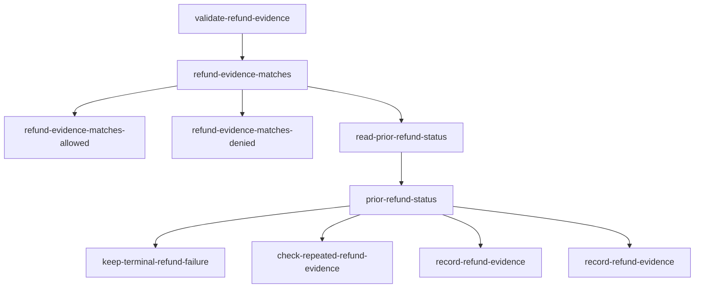

<!-- Generated by scripts/developer/flow-docs.mjs; do not edit this file. -->
# validate-refund-evidence

Production/generator input SHA-256: `0e120058e4b1c4edb368f3cb91abbea2f775ad545a0887b41d8eec057a831963`. Generated from actual registered builders using FootPrintJS 12.0.0 `toMermaid()`; callbacks/providers are not run.

Chart links target checkout sources. In an installed package use developer/node with the logical `src/...` ID; its manifest resolves `dist/source/...`. Hashes/line spans bind views to source. Static diagrams are not runtime evidence or complete host semantics.

This native topology view is used by 1 registered mount instance(s). Stable local aliases remove only the actual mount prefix; the complete actual-ID mapping and contexts are in [the manifest](../../manifest.json). Shared diagrams assert matching topology only, not identical private helper semantics.

## Decisions and loops

| Stage | Branch / control | Destination |
| --- | --- | --- |
| refund-evidence-matches | refund-evidence-matches-allowed | refund-evidence-matches-allowed |
| refund-evidence-matches | refund-evidence-matches-denied | refund-evidence-matches-denied |
| prior-refund-status | FAILED | keep-terminal-refund-failure |
| prior-refund-status | SUCCEEDED | check-repeated-refund-evidence |
| prior-refund-status | unsettled | record-refund-evidence |
| prior-refund-status | default | record-refund-evidence |

## Open a subflow

| Mount | Native subflow view | Mapping declarations |
| --- | --- | --- |
| SUCCEEDED | [check-repeated-refund-evidence](../read-settlement-status-74612c27d557/README.md) | inputMapper, outputMapper |
| unsettled | [record-refund-evidence](../read-settlement-status-d9c49e4d6dc9/README.md) | inputMapper, outputMapper |
| default | [record-refund-evidence](../read-settlement-status-d9c49e4d6dc9/README.md) | inputMapper, outputMapper |

## Guard and hook source

| Stage | Role | Source / boundary |
| --- | --- | --- |
| validate-refund-evidence | hook | [src/aftersales/runtime.ts:363](../../../../src/aftersales/runtime.ts#L363) · direct safe writes: `evidenceMatches` |
| refund-evidence-matches | decision | [src/aftersales/flowCharts.ts:120](../../../../src/aftersales/flowCharts.ts#L120) · safe fact `evidenceMatches` · [guard helper](../../../../src/aftersales/flowCharts.ts#L39) |
| refund-evidence-matches-denied | hook | [src/aftersales/runtime.ts:205](../../../../src/aftersales/runtime.ts#L205) · helper effects require source inspection |
| read-prior-refund-status | hook | [src/aftersales/runtime.ts:370](../../../../src/aftersales/runtime.ts#L370) · direct safe writes: `priorRefundStatus` |
| prior-refund-status | decision | [src/aftersales/flowCharts.ts:120](../../../../src/aftersales/flowCharts.ts#L120) · [callback](../../../../src/aftersales/flowCharts.ts#L122) |
| FAILED | hook | [src/aftersales/runtime.ts:380](../../../../src/aftersales/runtime.ts#L380) · direct safe writes: `outcome` |

[All registered flows](../../README.md)
