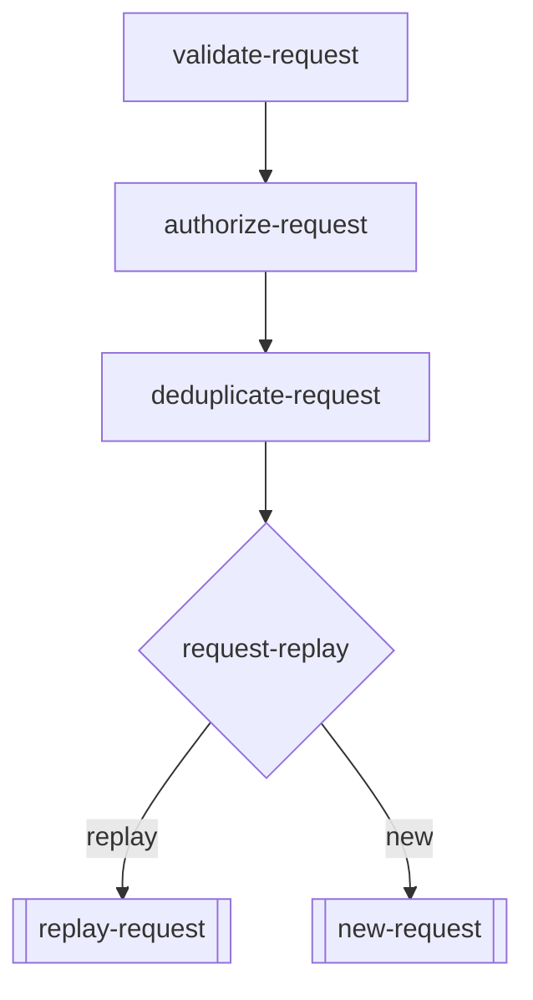

<!-- Generated by scripts/developer/flow-docs.mjs; do not edit this file. -->
# validate-request

Production/generator input SHA-256: `54ba490387d9ff380883910fbc0d35f5972f48e24193d35e980959ef15ed7649`. Actual registered builders: FootPrintJS 12.0.0 `toMermaid()` topology plus native control metadata; callbacks/providers are not run.

Chart links target checkout sources. In an installed package use developer/node with the logical `src/...` ID; its manifest resolves `dist/source/...`. Hashes/line spans bind views to source. Static diagrams are not runtime evidence or complete host semantics.

Native SDK topology with metadata-bound annotations: diamonds are actual decisions/selectors; double-sided boxes are subflows; hexagons are parallel forks; branch arrows show actual keys. Dashed “after selected/parallel branches” arrows are continuations after those branches complete, not bypass paths. Loop arrows are native back-edges. Callback exceptions, breaks, private predicates and host effects are not simulated; nested mounts open separate views.

This native topology view is used by 1 registered mount instance(s). Stable local aliases remove only the actual mount prefix; the complete actual-ID mapping, raw SDK text and edge-multiset proof are in [the manifest](../../manifest.json). Shared diagrams assert matching topology only, not identical private helper semantics.

## Algorithm

Generated from actual native stage labels and edges. Branch callbacks and host effects are not inferred. Numbering is a node inventory, not an execution trace.

1. Stage validate-request [validate-request]. Continuation: authorize-request.
2. Stage authorize-request [authorize-request]. Continuation: deduplicate-request.
3. Stage deduplicate-request [deduplicate-request]. Continuation: request-replay.
4. Decision request-replay [request-replay]. Branches: replay → replay; new → new. Continuation: end of this local path.
5. Subflow replay-request [replay]. Open its linked child view; Continuation: end of this local path.
6. Subflow new-request [new]. Open its linked child view; Continuation: end of this local path.

## Decisions and loops

| Stage | Branch / control | Destination |
| --- | --- | --- |
| request-replay | replay | replay-request |
| request-replay | new | new-request |

## Open a subflow

| Mount | Native subflow view | Mapping declarations |
| --- | --- | --- |
| replay | [replay-request](../read-replay-match-6972564a8d95/README.md) | inputMapper, outputMapper |
| new | [new-request](../load-request-order-3241bb124094/README.md) | inputMapper, outputMapper |

## Guard and hook source

| Stage | Role | Source / boundary |
| --- | --- | --- |
| validate-request | hook | [src/aftersales/runtime.ts:218](../../../../src/aftersales/runtime.ts#L218) · direct safe writes: `requestKind` |
| authorize-request | hook | [src/aftersales/runtime.ts:219](../../../../src/aftersales/runtime.ts#L219) · helper effects require source inspection |
| deduplicate-request | hook | [src/aftersales/runtime.ts:220](../../../../src/aftersales/runtime.ts#L220) · direct safe writes: `existingCase` · opaque repository.findCase |
| request-replay | decision | [src/aftersales/flowCharts.ts:71](../../../../src/aftersales/flowCharts.ts#L71) · [callback](../../../../src/aftersales/flowCharts.ts#L74) |

[All registered flows](../../README.md)
