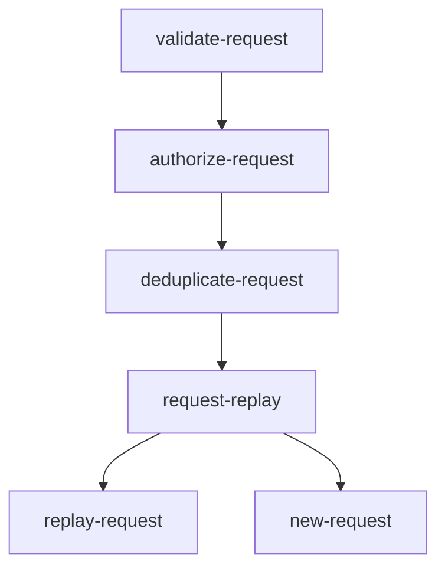

<!-- Generated by scripts/developer/flow-docs.mjs; do not edit this file. -->
# validate-request

Production/generator input SHA-256: `0e120058e4b1c4edb368f3cb91abbea2f775ad545a0887b41d8eec057a831963`. Generated from actual registered builders using FootPrintJS 12.0.0 `toMermaid()`; callbacks/providers are not run.

Chart links target checkout sources. In an installed package use developer/node with the logical `src/...` ID; its manifest resolves `dist/source/...`. Hashes/line spans bind views to source. Static diagrams are not runtime evidence or complete host semantics.

This native topology view is used by 1 registered mount instance(s). Stable local aliases remove only the actual mount prefix; the complete actual-ID mapping and contexts are in [the manifest](../../manifest.json). Shared diagrams assert matching topology only, not identical private helper semantics.

## Decisions and loops

| Stage | Branch / control | Destination |
| --- | --- | --- |
| request-replay | replay | replay-request |
| request-replay | new | new-request |

## Open a subflow

| Mount | Native subflow view | Mapping declarations |
| --- | --- | --- |
| replay | [replay-request](../read-replay-match-942182656867/README.md) | inputMapper, outputMapper |
| new | [new-request](../load-request-order-a127820a90ea/README.md) | inputMapper, outputMapper |

## Guard and hook source

| Stage | Role | Source / boundary |
| --- | --- | --- |
| validate-request | hook | [src/aftersales/runtime.ts:218](../../../../src/aftersales/runtime.ts#L218) · direct safe writes: `requestKind` |
| authorize-request | hook | [src/aftersales/runtime.ts:219](../../../../src/aftersales/runtime.ts#L219) · helper effects require source inspection |
| deduplicate-request | hook | [src/aftersales/runtime.ts:220](../../../../src/aftersales/runtime.ts#L220) · direct safe writes: `existingCase` · opaque repository.findCase |
| request-replay | decision | [src/aftersales/flowCharts.ts:71](../../../../src/aftersales/flowCharts.ts#L71) · [callback](../../../../src/aftersales/flowCharts.ts#L74) |

[All registered flows](../../README.md)
