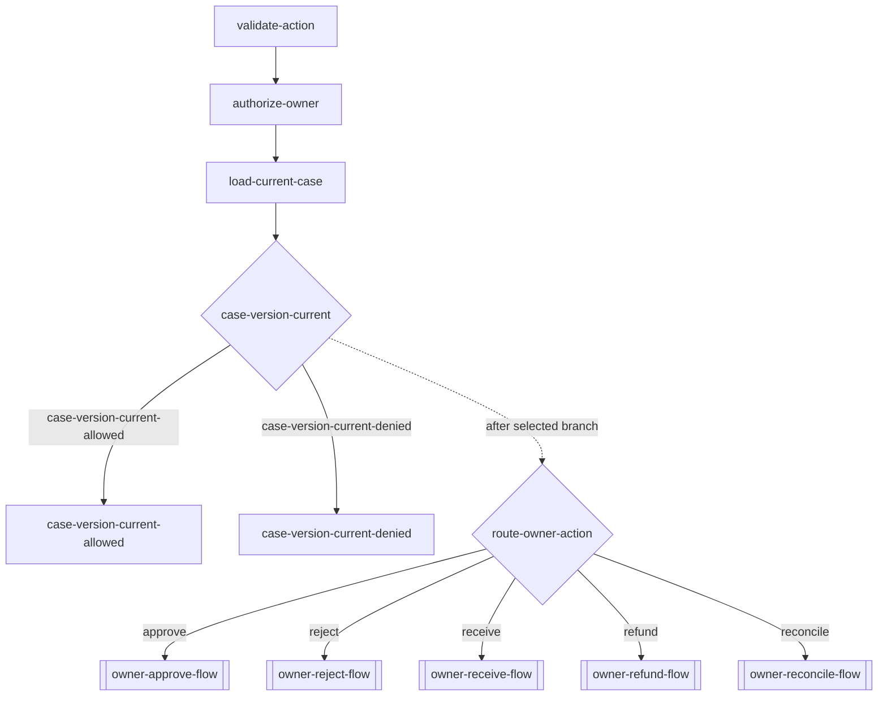
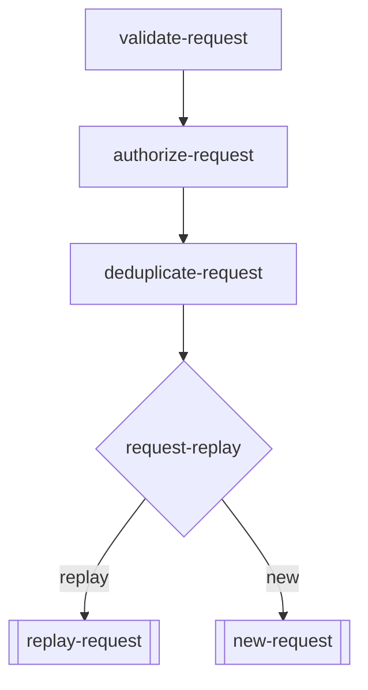

# After-sales runtime

Repository guide. `runtime.ts` implements private effects/predicates for `createAfterSalesService` using contracts in `../aftersales.ts`. Internal `flowCharts.ts` owns `buildRequestChart` and `buildActionChart`; these builders are not public exports. Start at the actual request or owner-action route. Approval, replay, item eligibility and refund choices are real native decisions fed by safe producer facts; private cases, commands, reasons, identities and payment objects remain closure-local.

For example, follow `request-item-loop` to the actual `inspect-request-item.lineCheck` position/eligibility tuple, or `refund-call-result` to `send-refund.refundCallReturned`. Full native capture applies only to safe booleans/fixed tags/counters/tuples. All semantic mounts explicitly isolate with empty mappings; `load-request-order` produces `requestKind` locally. Policy branches publish `policySatisfied`, while guards record their actual selected `branchResult`. Bounded item loops stay in their scope rather than creating one per item. No static relationship alone proves it caused a saved outcome.

Repository/payment ports own atomic allocation, version comparisons, reservations and durable idempotency. A source link cannot prove those opaque operations committed. Unknown refunds retain their original reservation and operation identity. Recording failure must not reverse acknowledgement or create another provider call.

Read [the after-sales contract](../../docs/AFTERSALES.md) and [saved scoped cause reader](../../docs/AFTERSALES-CAUSE.md), then run the relevant tests in `src/__tests__/aftersales/`. The working control refactor is unreleased and does not add missing evidence to old traces.

<!-- BEGIN GENERATED FLOW INDEX -->
## Generated after-sales chart views

Production/generator input SHA-256: `cad5181e473e3001f6b55752f12d9f9509786436f2743080765e0238b3e43dde`. Actual registered builders: FootPrintJS 12.0.0 `toMermaid()` topology plus native control metadata; callbacks/providers are not run.

### [aftersales-action](../../docs/flows/views/validate-action-3ca46934d91a/README.md)

### [aftersales-request](../../docs/flows/views/validate-request-07c1344f12e1/README.md)

Native SDK topology with metadata-bound annotations: diamonds are actual decisions/selectors; double-sided boxes are subflows; hexagons are parallel forks; branch arrows show actual keys. Dashed “after selected/parallel branches” arrows are continuations after those branches complete, not bypass paths. Loop arrows are native back-edges. Callback exceptions, breaks, private predicates and host effects are not simulated; nested mounts open separate views.

Open each root view for every actual mounted subflow, guard and hook source. Host ports/private payloads remain opaque; no callback is executed.
<!-- END GENERATED FLOW INDEX -->
