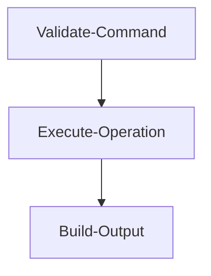

# Composed commerce flow wrappers

Repository guide. Start with `businessServiceComposer.ts`: it selects the action/profile factory, retains the private request, creates the executor/capture and verifies acknowledgement. `shared/businessFlow.ts` owns the common validate-command → execute-operation → build-output envelope. Catalog, order, subscriber and campaign factories select that envelope; they do not implement the host's transaction internals.

For a change, inspect the actual caller, selected branch, request mapping and configured `BusinessOperation`. Raw private input stays outside recorded scope. A complete wrapper body is not complete checkout/payment/publication semantics. Custom `flowRegistry` builders are trusted executable server code; describing them may build the chart.

Test with `src/__tests__/scenario/serviceComposer.test.ts`, `actionTracing.test.ts`, `providerPorts.test.ts` and the relevant action scenario. For recorded cause, continue into real host/provider evidence as described in [the agent guide](../../docs/AGENT-GUIDE.md).

<!-- BEGIN GENERATED FLOW INDEX -->
## Generated default service charts

Production/generator input SHA-256: `13517c9c684a32e0c2c721ce13e169b03e23eecc32e8fc99366938a759fd3439`. Actual registered builders: FootPrintJS 12.0.0 `toMermaid()` topology plus native control metadata; callbacks/providers are not run.

Actual default registry membership: [archive-product](../../docs/flows/views/validate-command-3af82d0c935a/README.md), [create-campaign](../../docs/flows/views/validate-command-3af82d0c935a/README.md), [create-order](../../docs/flows/views/validate-command-3af82d0c935a/README.md), [create-product](../../docs/flows/views/validate-command-3af82d0c935a/README.md), [create-subscriber](../../docs/flows/views/validate-command-3af82d0c935a/README.md), [process-payment](../../docs/flows/views/validate-command-3af82d0c935a/README.md), [publish-storefront](../../docs/flows/views/validate-command-3af82d0c935a/README.md), [schedule-campaign](../../docs/flows/views/validate-command-3af82d0c935a/README.md), [send-campaign-batch](../../docs/flows/views/validate-command-3af82d0c935a/README.md), [unsubscribe](../../docs/flows/views/validate-command-3af82d0c935a/README.md), [update-product](../../docs/flows/views/validate-command-3af82d0c935a/README.md), [update-stock](../../docs/flows/views/validate-command-3af82d0c935a/README.md).

These are library request envelopes. The configured authoritative host operation is opaque. Custom application registries/builders are not executed or inferred.
<!-- END GENERATED FLOW INDEX -->
